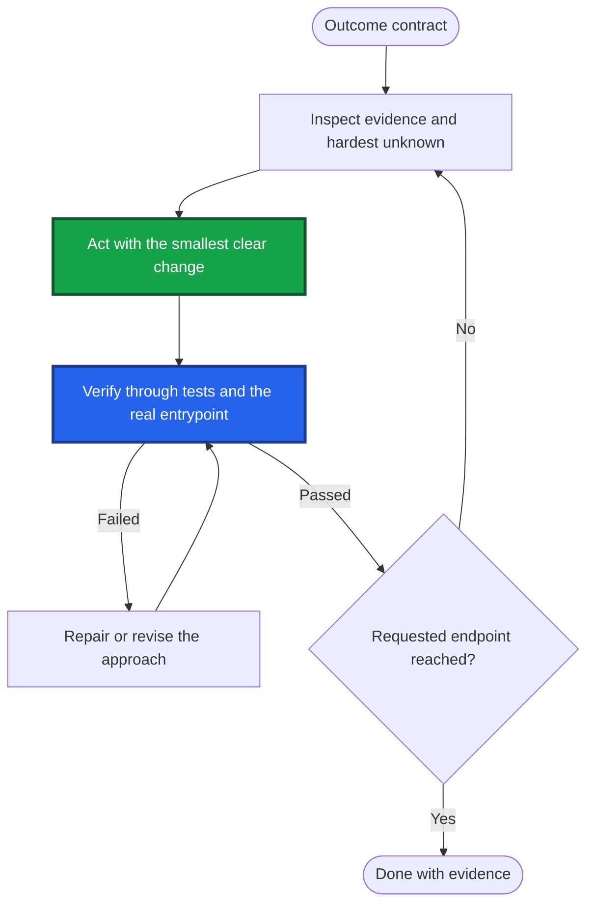
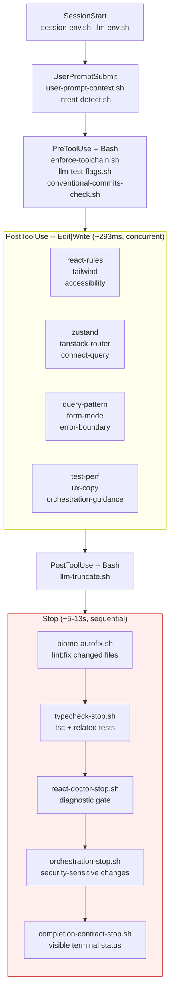

# Agent Skills

**Give Claude the outcome, a way to verify it, and the endpoint. Let it work.**

Hooks protect deterministic boundaries; skills disclose specialist knowledge only when a
task enters that domain. The primary model owns planning and execution without surprise
delegation, browser takeover, background wakeups, or unrequested shipping.


## Install

Run inside [Claude Code](https://docs.anthropic.com/en/docs/claude-code) session (start with `claude` in terminal):

```bash
/plugin marketplace add malinskibeniamin/skills
```
```bash
/plugin install frontend-skills@skills
```
```bash
/reload-plugins
```

Three commands. Skills, hooks, agents activate immediately. Done.

**Recommended: rtk** (output-compression proxy, ~60-90% token savings on git/cargo/test/gh):

```bash
brew install rtk
rtk trust            # approve .rtk/filters.toml per project
```

Every non-empty Bash call is offered to RTK. Supported commands are rewritten before execution; unsupported commands and missing RTK pass through unchanged. Native Read/Grep tools do not cross the Bash hook.

**Update** (refresh the catalog, then pull latest):

```bash
claude plugin marketplace update skills
claude plugin update frontend-skills@skills
```

Restart Claude Code session so hooks reload from new cache.

The unreleased bundle retires Ponytail and `/deslop`, including their review
policy and LOC nudges. Reload or restart the host after upgrading so previously
loaded instructions do not remain active. Use `/review` for correctness review
or `/improve` for a requested codebase audit.

**Verify:**

```bash
CLAUDE_PLUGIN_ROOT="$(
  claude plugin list --json |
    jq -er '.[] | select(.id == "frontend-skills@skills" and .enabled) | .installPath'
)"
bash "$CLAUDE_PLUGIN_ROOT/scripts/verify-install.sh" --remote origin
```

### Optional Claude Code mods

On **Claude Code 2.1.287 or later**, add the separate `frontend-skills-mods` plugin:

```bash
/plugin marketplace update skills
/plugin install frontend-skills-mods@skills
/reload-plugins
```

**Harness desk** adds `/harness proof` (check receipts), `/harness skills` (Skill
Flight Recorder) and `/harness replay` (successful returned edit patches) in one
native pane. Context and last-skill readouts remain above the prompt. Observations
are not skill adherence or release certification; stale/unavailable comparisons
and missing dogfood/visual evidence stay explicit. Git comparison is read-only;
replay is bounded session memory with best-effort secret exclusions, not undo.
Live terminal/Desktop painting and before/after captures remain unverified.

Existing `frontend-skills` shell hooks and Codex installs stay unchanged. Mods have
Claude Code's access to your machine: install only trusted code, including when a
mod appears read-only. Disable with `claude plugin disable frontend-skills-mods@skills`;
remove with `claude plugin uninstall frontend-skills-mods@skills`, then reload plugins.
See the [mod README](plugins/frontend-skills-mods/README.md) for verification and
[mod authoring](extend-harness/MODS.md) when extending the harness.

**Codex (OpenAI)** -- install as a Codex plugin from the repo's marketplace manifest:

```bash
brew upgrade --cask codex
codex features enable plugins
codex features enable hooks
codex plugin marketplace add malinskibeniamin/skills --ref v4.41.0
codex plugin marketplace upgrade skills
codex plugin add frontend-skills@skills
```

Track `main` instead of the pin with `--ref main`. Restart Codex after adding or upgrading so the Plugins UI reloads metadata.

### React DevTools runtime inspection

Optional [React runtime inspection](shared/react-devtools.md) connects component
props/hooks, ownership, source and render timings to `/diagnosing-bugs`,
`/ux-performance` and `/dogfood`. The harness ships a
[pinned, isolated localhost MCP config](config/react-devtools.mcp.json) and a bounded
`react-devtools` hook exception; it does not enable a server or instrument apps by default.
Follow the guide to configure the MCP client and consumer app's dev-only bootstrap.
Missing capabilities retain existing workflows; React observations do not replace tests
or production-like UX measurements.

### TraceDecay code graph

This harness uses [TraceDecay](https://github.com/ScriptedAlchemy/tracedecay) as a
user-level Codex companion for semantic code search, call graphs, impact analysis, and
affected-test selection. It remains a separate installation so projects do not acquire a
runtime dependency.

Recommended opt-in setup after installing the Codex plugin:

```bash
FRONTEND_SKILLS_ROOT="$(
  codex plugin list --json |
    jq -er '.installed[] | select(.pluginId == "frontend-skills@skills").source.path'
)"
bash "$FRONTEND_SKILLS_ROOT/scripts/setup-tracedecay.sh" --agent codex --project "$PWD"
```

The helper shows its scope and asks before changing the machine or repository. It installs
a missing binary through Homebrew, configures the selected host, starts the user daemon,
enrolls the current project only when needed, and runs `tracedecay doctor`. Use `--dry-run`
to preview it. The installation remains optional and the harness continues to fail open
when TraceDecay is absent.

Manual fallback:

```bash
brew install ScriptedAlchemy/tap/tracedecay
tracedecay install --agent codex
codex plugin add tracedecay@personal
tracedecay daemon install-service
```

Enroll each repository once, then start a new Codex or Conductor agent session:

```bash
cd /path/to/repository
tracedecay init
tracedecay doctor --agent codex
```

Linked worktrees share one enrollment and keep branch-specific graph databases. Check
`tracedecay tool active_project --json` if results appear to come from another branch; after
the first linked-worktree enrollment, run `tracedecay daemon restart` once if the daemon
still reports the initial database.

**Token-first hook profile:** TraceDecay v0.0.73 `UserPromptSubmit` emitted about 2,600
characters on every prompt in dogfood testing. Disable only that TraceDecay hook through
Codex `/hooks`; keep SessionStart, PostToolUse, PostCompact, and Stop for startup guidance,
incremental sync, compaction recovery, and session ingestion. Re-measure after TraceDecay
upgrades before changing the profile.

**Fallback: individual skills via skills.sh** -- when you want specific skills instead of the full plugin:

```bash
bunx skills@latest add malinskibeniamin/skills/frontend-starter-kit --agent claude-code -y
bunx skills@latest add malinskibeniamin/skills/development-lifecycle --agent claude-code -y
bunx skills@latest add malinskibeniamin/skills/work-automation-kit --agent claude-code -y
```

Want proof and examples? Demo scripts, featured skill moments, and starter prompts live in [docs/DEMOS.md](docs/DEMOS.md); comparisons, measurement methodology, and common questions live in [docs/FAQ.md](docs/FAQ.md).

## Review evidence

Optional [review gates](review/GATES.md) connect existing specialist skills to a
candidate-bound coverage plan, validated findings, safe reruns and a generated PR table.
The same state feeds readiness checks; missing, stale and invalid results remain visible.
Use inline review or explicitly authorized specialists. Planning never dispatches agents,
changes models or grants merge permission. Consumer-specific gates add to the shared
catalogue without replacing its responsibilities.

Run `bun run review:gates --help` in this checkout, or the installed
`scripts/review-gates.ts` from a consuming repository. No extra runtime dependencies.

## Factual technical writing

Use `/docs` to write or review READMEs, design specs, research notes, and runbooks with
sourced claims, reproducible results, and link verification. It works in Claude Code and
Codex. [Upstream provenance](vendor/flightrules/NOTICE.md) and
[host adaptations](shared/FLIGHTRULES-COMPATIBILITY.md) keep the docs-only snapshot separate
from this harness's workflows.

For the same communication principles throughout a Claude Code session, open `/config`,
choose **Output style**, and select the plugin's `factual-docs` style. It is opt-in and keeps
coding instructions. Installing the plugin does not select it or change your settings.
The workflow remains `/docs`; the style does not impose document sections or filenames on
ordinary chat. [Claude output-style reference](https://code.claude.com/docs/en/output-styles).

## Browse the docs

The Blume site turns every canonical `SKILL.md` into a searchable page without a
second documentation copy. Skill names, descriptions, instructions, and new skills are
picked up automatically.

```bash
bun run docs:dev    # local site with hot reload
bun run docs:check  # content and Astro checks
bun run docs:build  # static output in docs-site/dist
bun run docs:translate        # refresh zh-CN, zh-TW, and pl with Codex
bun run docs:translate:check  # fail when a translation is missing or stale
```

The English filesystem pages are generated from the canonical `SKILL.md` files and
ignored by Git. Blume commits only the translated pages and its freshness ledger, so
English guidance still has one source of truth.

## How it all connects

```
You: "Build feature X" or "Fix these 5 issues overnight"
  │
  ├── Interactive ──-> Claude Code + an outcome contract
  │                    └── inspect -> act -> verify -> repeat
  │
  └── Automated ───-> Routines (claude.ai/code/routines)
                      └── schedule, GitHub webhook, or API trigger
                          └── cloud session with hooks + CLAUDE.md active
                              └── PR review, triage, health checks, docs drift
```

### Two everyday entry points

- **`/work <outcome>`** authors or finishes work through the requested endpoint. It selects
  tests, dogfood, inline review, impact evidence, useful visuals and PR presentation itself.
- **`/review <branch or PR>`** assesses existing work, including your own, and returns
  evidence-backed findings. Editing, posting and delivery require explicit intent.

```text
/work   -> implement/repair -> verify + self-review -> requested delivery
/review -> inspect + verify -> findings only
                            -> author repair loop only when explicitly requested
```

Say the endpoint once: local, commit, push, draft PR, verified readiness, or explicitly
merged. Ordinary implementation defaults to push; draft PR stops after publication and
one CI snapshot. Ship/readiness owns CI and feedback repairs, not automatic merge.

[Evidence routing](shared/change-evidence.md) selects real screenshots/video for visible
changes, diagrams for changed relationships, and measurements for performance claims.
Product motion uses `animate`; synthetic explainers never replace real UI recordings.
Specialists load when applicable, not as a fixed checklist for every change.

Existing commands remain compatible: `/development-lifecycle` implements the author path,
`/go` selects readiness, `/full-send` selects authorized merge unless narrowed, and
`/commit-push-pr` handles publication. `/pr-shepherd` or `/work maintain all my open PRs`
runs one repository sweep, repairs only this workspace and routes other owners. These
are presets/helpers, not extra commands to chain. History cleanup and unattended jobs
remain explicit opt-ins.

Delivery ownership: [diagram](docs/architecture/author-delivery.png) and
[editable source](docs/architecture/author-delivery.excalidraw).

### tstack skills

All nine [tstack](https://github.com/t3dotgg/tstack) skills ship as a
[pinned, MIT-licensed snapshot](vendor/tstack-NOTICE.md). Eight new entrypoints
compose existing owners: `/full-stop`, `/file-pr`, `/babysit-pr`, `/takeover`,
`/modernize`, `/council`, `/sol-loop` and `/leaving-pr-comments`. `/full-send`
keeps its existing owner. Publication, monitoring, watchdog takeover and feedback
load the matching guidance automatically, not a second workflow stack.

[Host compatibility](shared/TSTACK.md) preserves requested drafts, narrower
endpoints, ownership and protected review gates. Council and sol loop require
explicit delegation; other workflows never start them automatically. Vendoring
does not start watchers, install services or grant merge authority.

### Interface craft and workbenches

All 14 [Jakub Krehel interface skills](https://github.com/jakubkrehel/skills)
ship as a [pinned MIT snapshot](vendor/jakubkrehel-NOTICE.md), with their references
and teardown viewer helpers intact. [Host composition](shared/INTERFACES.md)
connects them to visual review, accessibility, UI copy, motion, mobile, stress
checks, prototypes and design implementation. Existing owners keep their workflows;
project tokens, safety requirements and requested delivery endpoints take precedence.

`/better-interface`, `/better-ui`, `/better-typography`, `/better-colors`,
`/better-accessibility`, `/better-layout`, `/better-writing`, `/build-design` and
`/teardown` are discoverable specialists. `/interface-review`, `/explain-interface`,
`/break`, `/state-machine` and `/variant` retain explicit-only invocation on both
hosts. Workbench routes/fixtures stay out of production PRs. Vendoring installs
no dependencies and starts no browser, process or agent.

### Outcome contract

Most work needs four fields, not a prescribed workflow:

```md
Objective: the high-level end state
Guardrails: non-inferable constraints and reserved decisions
Verification: tests, commands, or observable behavior that prove success
Stop: the requested endpoint and genuine blockers
```

The model then owns one evidence loop:



**Four layers, one outcome:**

| Layer | What | How | Reliability |
|---|---|---|---|
| **Skills** | Specialist knowledge | Loaded only when the observed task enters that domain | Progressive |
| **Hooks** | Enforce quality | PostToolUse + Stop hooks, every edit | 100% automatic |
| **Agents** | Optional specialization | Explicit delegation or `/swarm` only | Never automatic |
| **Routines** | Automate | Cloud-hosted sessions on schedule/webhook/API | Unattended, 24/7 |

## Why this exists

| Problem | Without repo | With repo |
|---|---|---|
| Claude write `as any` | Ships to PR -> human catches -> feedback loop | Hook blocks immediately -> 50 tokens -> fixed |
| Claude misses meaningful behavior | Ships -> human finds regression | TDD + review require public-contract proof |
| Claude use wrong patterns | 3-5 human review cycles per PR | 0-1 human review cycles per PR |
| Forget ask accessibility | No a11y until manual audit | Every component checked automatically |
| Must babysit every step | Manual: "now write tests", "now check types" | Ordinary work plans briefly, then continues |

**How it works**: deterministic hooks guard mechanical boundaries without spending model
tokens. Skills disclose specialist knowledge when the observed task needs it. Outcome and
verification stay with one primary model.

**vs. [obra/superpowers](https://github.com/obra/superpowers)**: Superpowers give great workflow skills (TDD, debug, plan). We take their best patterns AND add what they lack: **mechanical enforcement via hooks**. Superpowers teach Claude what do. We teach AND enforce -- if Claude forget, hook catch.

## When not to use this

Honest scoping -- this harness is **opinionated**. Here's when to skip it or fork it:

| Don't use if | Why |
|---|---|
| Backend-only repo (Go/Python/Rust) | React/TypeScript hooks add no value; fork the lifecycle skills only |
| Non-React frontend (Vue, Svelte, Angular) | ~80% of checks are React-specific |
| Throwaway prototype / spike | Stop gate blocks commits without tests; kills exploration velocity (set `ORCHESTRATION_STRICT=0` if keeping the plugin) |
| Can't use Bun | `enforce-toolchain.sh` bans npm/npx/yarn by default (configurable, but friction) |
| No Claude Code / Codex access | Hooks are harness-specific; nothing to enforce |
| Stack: not (TanStack Router + ConnectRPC + Protobuf v2) | Many setup skills assume this; fork to strip them |
| Team rejects opinionation | Setup skills pin choices (Biome over ESLint, TypeScript 7 (`tsc` or tsrs) over preview-era `tsgo`, Vitest over Jest) |

**Partial adoption works.** Install only the specialist skills or hook groups your tasks
and evals justify.

## Skills catalog

Most work needs no named skill. `/development-lifecycle` provides the compact execution
contract for frontend implementation. Everything else is optional specialist guidance or
an explicit artifact command.

| Category | What it covers | Representative skills |
|---|---|---|
| Workflow | Build, ship, review, value-check, debug | `/work`, `/review` (specialists and delivery presets selected as needed) |
| Kits | Bundles that install groups | `/frontend-starter-kit` (profiles: `full`, `minimal`, `redpanda`, per-tool), `/work-automation-kit`, `/codex-compat` |
| Guidance | Auto-load on matching files | `/accessibility`, `/tanstack-router`, `/connect-query`, `/e2e-testing`, `/registry-workflow`, `/ux-copy` |
| Infra | Slash-only setup | `/setup-routines` (cloud automation), `/setup-atlassian-workflow` (Jira via acli) |
| Agents | Optional, explicit delegation | `code-reviewer` (PR correctness), `verifier` (read-only verification) |

The router [ask-ben/SKILL.md](ask-ben/SKILL.md) discloses the generated [complete skill catalog](ask-ben/SKILL-CATALOG.md) on demand.

## How it works

Three layers automation run without manual invocation:

**Layer 1 -- Dynamic Context** (every prompt, ~30ms): Record the requested endpoint and inject only facts the model cannot know, such as current branch and explicit PR identity. It does not prescribe a workflow.

**Layer 2 -- Pattern Enforcement** (every Edit/Write, ~293ms): PostToolUse hooks catch violations real-time. Claude see error, fix, hook re-check -- cycle repeat until clean. Plus file-aware guidance: write test file -> async leak tips, write component -> accessibility checklist.

**Layer 3 -- Quality Gate** (when Claude finishes, <10s): Stop hooks verify local quality,
reject silent completion once, and enforce only the requested endpoint. Local implementation
never auto-commits or opens a PR.

**Auto-loading skills**: Skills with `paths:` frontmatter auto-load when Claude work on matching files. Write test -> TDD patterns load. Edit route -> TanStack Router patterns load. No `/skill-name` invocation needed.

Never see hook output directly. Claude just produce better code, with tests, accessible, secure, type-safe -- without asking each thing individually.

### Configuration

| Env var | Default | What does |
|---------|---------|--------------|
| `PROMPT_CONTEXT_LEVEL` | `standard` | How much state inject per prompt (`minimal`, `standard`, `full`) |
| `ORCHESTRATION_STRICT` | `1` | Set `0` during prototyping to disable "must have tests" gate |
| `REACT_COMPILER_MODE` | `infer` | Set `annotation` for brownfield codebases |
| `HOOK_VERBOSITY` | `normal` | `terse` = blocks only (suppress warns), `quiet` = all output suppressed |
| `HOOKS_FAIL_CLOSED` | `0` | Set `1` to block on hook script errors (catch misconfiguration) |
| `HOOK_SHADOW_RULES` | empty | Comma-separated non-strict rule labels to log without steering or blocking |

Use shadow mode for controlled model-release holdouts. Compare equivalent tasks with
version-qualified telemetry before retaining or deleting a rule. Strict blocks and
permission denials are never shadowed.

## Why hooks over skills over manual prompting

| Approach | Reliability | Token cost | Latency | Human effort |
|----------|-------------|------------|---------|--------------|
| Manual prompting | 0% (forgotten) | 0 extra | 0 | High (remember every rule) |
| Skills on-demand | ~70% (Claude may skip) | ~500 tokens/skill | ~0ms | Low |
| Skills with `paths:` | ~90% (auto-load on file match) | ~500 tokens/skill | ~0ms | None |
| PostToolUse hooks | 100% (always fires) | 0 (bash scripts) | ~293ms | None |
| UserPromptSubmit hooks | 100% (every prompt) | 0 (bash) + context | ~120ms | None |
| Stop hooks | 100% (every turn end) | 0 (bash) + test run | ~4-10s | None |

## Hook architecture

Hooks fire automatic at each stage of Claude Code session. PostToolUse hooks run concurrent for speed; Stop hooks run sequential as final quality gate.



The authoritative hook inventory (every lifecycle event and the scripts wired to it) lives in [skill-manifest.json](skill-manifest.json), the source of truth that generates the plugin hook configs. Non-JS/TS file edits (Go, Python, Markdown, and so on) get zero overhead -- all hooks exit immediately on non-matching file extensions.

## Toolchain enforcement

Bootstrap setup consolidated into **one skill** (4.27.0): `/frontend-starter-kit` with
profiles `full | minimal | redpanda | <tool>`. Each tool's install steps live in
`frontend-starter-kit/references/<tool>/` and load lazily -- toolchain (bun+TypeScript 7 `tsc` or tsrs, destructive
command guards), biome (+Ultracite, auto-fix Stop hook), quality-gate, agent-config,
react-compiler, react-rules, zustand, env-validation (t3-env+zod), conventional-commits,
react-doctor, ci-pipeline, redpanda (registry workflow, `REDPANDA_KIT=1`).

Daily-work guidance formerly hidden behind `setup-` names is now directly model-invoked:
`/accessibility`, `/tanstack-router`, `/connect-query`, `/e2e-testing`, `/registry-workflow`,
`/ux-copy`. Optional infra stays slash-only: `/setup-routines` (cloud routines) and `/setup-atlassian-workflow` (Jira via acli).

```
bunx skills@latest add malinskibeniamin/skills/frontend-starter-kit --agent claude-code -y
```

## Codex compatibility

Codex = first-class harness. Supported equivalent hooks are mapped directly: SessionStart, UserPromptSubmit, PreToolUse, PostToolUse, Stop, plus Codex-only PermissionRequest through an adapter that reuses hard-deny Bash/MCP guardrails. Claude PostToolUseFailure maps to Codex PostToolUse because Codex post-tool hooks include failed Bash commands. Claude-only events without Codex equivalents (FileChanged, compact hooks, SessionEnd, Subagent hooks, WorktreeCreate) stay Claude-only until Codex adds matching lifecycle events. `AGENTS.md` at repo root replaces PostCompact context re-injection.

All hook paths use `$(git rev-parse --show-toplevel)` for resolution -- works from any CWD, silently skip in repos without hooks installed.

- **codex-compat** -- Install `.codex/hooks.json`, batch checker, `AGENTS.md`. Session state harness-agnostic (`CLAUDE_SESSION_ID` or `CODEX_SESSION_ID`).

  ```
  bunx skills@latest add malinskibeniamin/skills/codex-compat --agent claude-code -y
  ```

## Evals

Two layers testing prevent regressions:

**Script-level evals** -- verify hook scripts, file structure, content. Run locally in <5 seconds:

```
./evals/run.sh
```

**Agent-level evals** -- behavioral tests using [@vercel/agent-eval](https://github.com/vercel-labs/agent-eval) verify Claude Code actually follows rules when given adversarial prompts. Runs in Docker sandbox:

```
cd agent-evals && bun install --yarn && bun run eval
```

Run only the adversarial AIP design review with `bun run eval -- aip`.

Major model releases have two paid, opt-in gates. Context ablation measures how much ambient
instruction the model needs. Capability probes separately compare specialized research,
data-analysis, debugging, computer-use, vision/3D, and explicitly authorized coordination
work without promoting release claims into routing policy:

```
agent-evals/context-ablation/run.sh --dry
agent-evals/capability-probes/run.sh --dry
```

## Credits and provenance

Everything this harness uses from [mattpocock/skills](https://github.com/mattpocock/skills) is vendored locally -- nothing needs installing from the upstream repo. Vendored: `ask-ben`, `tdd`, `triage`, `diagnosing-bugs`, `handoff`, `codebase-design`, `improve-codebase-architecture`, `domain-modeling`, `grilling`, `prototype`, `research` (v1.1.0 rewrite, restored on owner request), `teach` (slash-only, kept on owner request), `to-questionnaire`, `to-spec`, `to-tickets`, `wait-what`, `writing-for-agents`, `wayfinder`, `wizard`, and the v1.3 graduations `implement-spec`, `pr` (credited to Dex Horthy's `show-me`), and `retro`. Reconciled against [v1.3.1](https://github.com/mattpocock/skills/releases/tag/v1.3.1), including explicit dependency loading and human-selected retrospectives. Upstream-removed `resolving-merge-conflicts` is retired. Upstream skills judged dead, off-domain, superseded, or contradictory to this harness (obsidian-vault, scaffold-exercises, implement, loop-me, migrate-to-shoehorn, setup-pre-commit, git-guardrails-claude-code, edit-article, batch-grill-me, spawn) are not registered.

Post-v1.3.1 fixes are adapted through [upstream `49dd158`](https://github.com/mattpocock/skills/tree/49dd158d1076134a641b33efb035946536778336). Upstream MIT attribution is retained in [LICENSE](LICENSE); no duplicate pack or automatic issue-closing policy is installed.

Existing domain docs must move with the skills update: `git mv CONTEXT.md GLOSSARY.md`
and, when present, `git mv CONTEXT-MAP.md GLOSSARY-MAP.md`. Coordinate one commit across
the team to avoid creating a second, empty glossary. Released documentation snapshots retain
their historical filenames.

Six focused skills from [Emil Kowalski](https://github.com/emilkowalski/skills) are adapted locally: `/animate`, `/animation-performance`, `/animation-vocabulary`, `/mobile-native`, `/break-ui`, and `/ask-sonner`. Motion review, audit, and opportunity searches share `/animate`; existing design/prototype workflows remain owners. The fixed library picker and native Swift/Expo skills are not installed. [Selection, pinned sources, compatibility changes, and refresh steps](shared/EMIL-SKILLS-CREDITS.md).

Several workflow skills are vendored from [Builder.io](https://www.builder.io) Agent-Native patterns (`/visual-plan`, `/visual-recap`, `/agent-watchdog`, `/plan-arbiter`, `/plow-ahead`, `/read-the-damn-docs`, `/efficient-frontier`) and from the Cursor Team Kit (`/what-did-i-get-done`).

`/webmcp <url-or-app> [request]` opens a web app in the built-in browser and uses
its page tools; without a request it only opens the page. For building or auditing
WebMCP tools, the same skill routes internally to pinned Chrome Labs guidance:
state-scoped registration, actionable errors, React lifecycle/types and in-page
computation. Builder.io's page-operation skill remains pinned too. Only the local
host adapter is registered; no browser, runtime dependency or connector is installed.
[Sources, licenses, compatibility and refresh](webmcp/CREDITS.md).

`/software-factory` assesses whether repeated ticket-to-PR work justifies automation, then plans a bounded pilot and infrastructure. It adapts Matt Pocock's in-progress draft, adds an orchestrator survey alongside the upstream git-host, ticket-tracker, and runner research, and starts no automation. [Harness fit](software-factory/HARNESS-FIT.md) records the proposed pilot; [source pin, license, and refresh](vendor/software-factory-NOTICE.md) distinguish the draft snapshot from local policy.

`/cli-for-agents` adds Cursor's guidance for non-interactive, composable CLIs through a host-safe adapter. [Pinned sources, licenses, selection, and refresh](shared/CURSOR-SKILLS-CREDITS.md) cover the Cursor recheck; provider-specific integrations and duplicate workflows remain unregistered.

The **complete [Poteto/pstack](https://github.com/cursor/plugins/tree/main/pstack) stack** is vendored: all **59 skills** from pstack **0.15.29** (56 core/principle skills plus all 3 Benny skills), all 23 mode playbooks, references, agents, scripts, templates, guide assets, and the MIT license. The byte-exact source is pinned to [`88d47514b82e7c44f00f2b2a72ff6dd12158038c`](https://github.com/cursor/plugins/tree/88d47514b82e7c44f00f2b2a72ff6dd12158038c/pstack) in [`vendor/pstack.lock.json`](vendor/pstack.lock.json).

The refresh adds `/poteto-create-formal-verification-skill`, `/poteto-maintain-formal-verification-skill`, `/poteto-in-your-own-words`, and `/poteto-sharpen`. These remain explicit-only; importing them runs no verifier or setup.

Use `/poteto-mode`, `/poteto-how`, `/poteto-architect`, `/poteto-interrogate`, or any `/poteto-<upstream-folder>` skill through Claude or Codex. Every upstream `SKILL.md`, including the Benny automation pack, has a registered adapter in `poteto-skills/`; none are excluded. The complete inventory is linked above; authored-skill docs stay separate from imported source. The prefix avoids replacing this harness's `/tdd`, `/swarm`, `/teach`, `/blast-radius`, `/create-verification-skill`, and `/maintain-verification-skill`. Upstream invocation policies are preserved. [Compatibility rules](shared/POTETO-COMPATIBILITY.md) keep the requested endpoint, selected model, host tools, and explicit delegation/automation authorization intact. Installation activates no automation or upstream agent. `/poteto-help` guides setup and skill selection; `/poteto-ketchup` summarizes this chat and pending decisions. Active roles use only Opus 5.5 and GPT-6.1 Sol at `xhigh`; upstream Grok defaults are inert source material, not permitted routes.

Verify the snapshot with `python3 scripts/vendor-poteto.py --check`. Refresh from a separate checkout of `cursor/plugins` at a reviewed full SHA:

```bash
python3 scripts/vendor-poteto.py --model-rule # print the host's two-model rule; writes nothing
python3 scripts/vendor-poteto.py --source /path/to/plugins/pstack --revision <full-commit-sha>
bash scripts/generate-skill-catalog.sh
```

The command discovers every skill recursively, copies the complete source tree unchanged, records file hashes and executable permissions, and generates namespaced adapters and Claude registrations. The catalog generator then derives Codex proxies and router entries from that inventory. Vendored Cursor runtime code is not reformatted or checked against this repository's toolchain.

`/test-audit` is vendored from [openclaw/openclaw](https://github.com/openclaw/openclaw/tree/main/.agents/skills/test-audit) (MIT, notice in `test-audit/CREDITS.md`): an authoring gate `/tdd` routes new tests through, plus audit and subsystem-campaign modes for pruning low-value tests and their test-only production seams.

[`/ci-fixes`](ci-fixes/SKILL.md) audits CI latency, test signal, and delivery integrity:
nightly routing, caching, workers/shards, affected-only selection, runner sizing, upgrades,
flake repair, and evidence-backed test pruning. The extensible audit also covers reproducible
builds, artifact identity, execution trust, rollout compatibility, recovery, diagnostics,
evidence privacy, and policy drift. PR browser tests mock backend traffic; optimizations
must preserve unique regression detection and coverage.

`/security-audit` vendors the complete
[Cloudflare security-audit-skill](https://github.com/cloudflare/security-audit-skill)
package: source-first guidance, domain companions, report schema, and findings and
coverage validators. The [host adapter](security-audit/SKILL.md) keeps focused
questions in guidance mode; full audits require explicit delegation consent and
upstream sandbox controls. No automatic security-review hook is restored.
[Pinned source and MIT attribution](security-audit/CREDITS.md).

`/effect-ts` and `/effect-v3-to-v4` are vendored from
[Effect-TS/skills](https://github.com/Effect-TS/skills). They cover repository setup
and explicitly invoked v3-to-v4 migrations. Upstream revision, refresh sources,
local adaptations, and the MIT notice live in
[shared/EFFECT-SKILLS-CREDITS.md](shared/EFFECT-SKILLS-CREDITS.md).

All **15 skills from T3 Code's reviewed checkout** ship as local adapters with
unchanged upstream instructions, references, helpers and MIT licenses. The source
is pinned at [`1451e7c`](https://github.com/pingdotgg/t3code/tree/1451e7cb23034d29774338608368a15d8845df36)
in [the snapshot lock](vendor/t3code-skills.lock.json).

- CI and imports: `/ci-maintenance`, `/vendored-assets`.
- Library/toolchain work: `/test-development`, `/bundle-analysis`, `/changesets`,
  `/package-development`, `/performance-analysis`, `/dependency-maintenance`, `/jsdocs`.
- Effect: `/effect-development`, `/migration-guidance`, `/ai-docs`. The latter two
  maintain Effect's own generated references, not application migrations or prose.
- T3-specific work: `/contribution-triage`, `/test-t3-app`, `/test-t3-mobile`.

The [host contract](shared/T3CODE-SKILLS.md) keeps existing TDD, upgrade, performance,
release and review owners. Browser/Device tools remain T3-only, and moderation requires
the target's trusted policy and authorized scope. Importing skills enables no runtime
hooks, tooling or automations. [Sources, licenses and refresh](vendor/t3code-NOTICE.md).

`/eli5` adapts the beginner-first visual artifact idea from
[Anthropic's community ELI5 plugin](https://github.com/anthropics/claude-plugins-community/tree/main/eli5),
authored by Thariq Shihipar.

TanStack packages ship version-matched guidance through TanStack Intent. `/tanstack-intent`
discovers and loads the installed framework's task-specific skills before any TanStack
answer or change; the full starter kit runs `bunx @tanstack/intent@latest install --map`
and installs the official Claude/Codex hooks. Lifecycle patterns (TDD red/green, grilling,
writing-for-agents) are inspired by or vendored from [obra/superpowers](https://github.com/obra/superpowers); this harness adds mechanical enforcement on top.

## Automatic security review: intentionally absent

Automatic model-driven security review (per-edit security-audit hook, the review security hat, auth-path adversarial triggers) was removed by owner decision on 2026-07-10 after persistent false-positive flagging of legitimate cybersecurity work. Deterministic scanning (`/snyk-ux-security`, Biome) remains; `/security-audit` supplies task-scoped guidance and explicitly requested audits, not automatic coverage. Do not assume security coverage from this harness.
