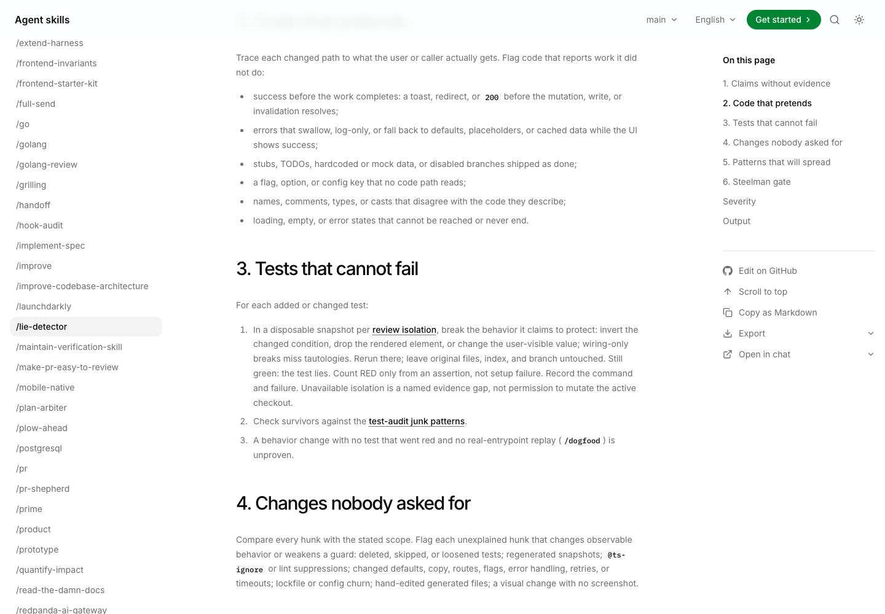
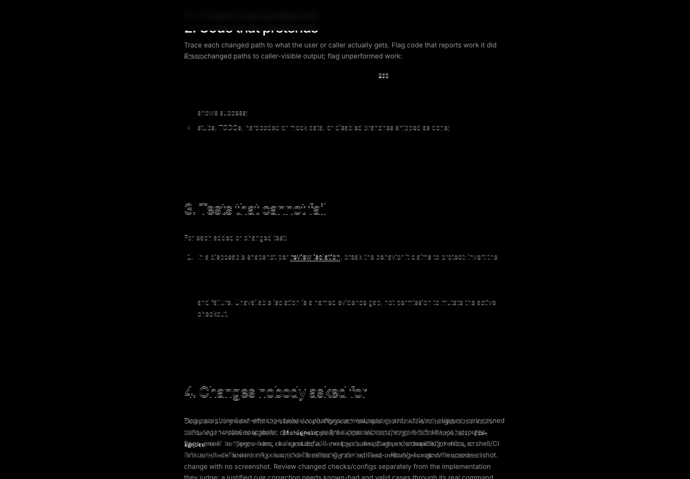
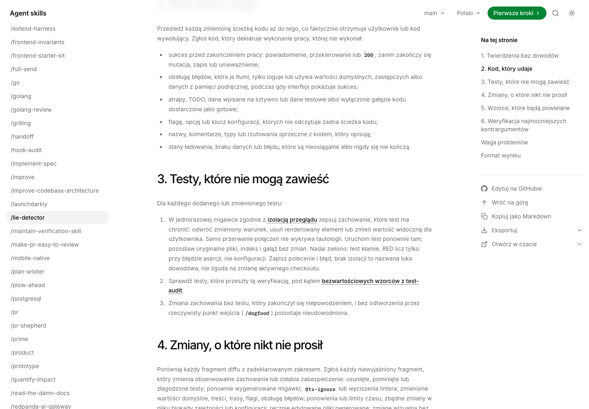
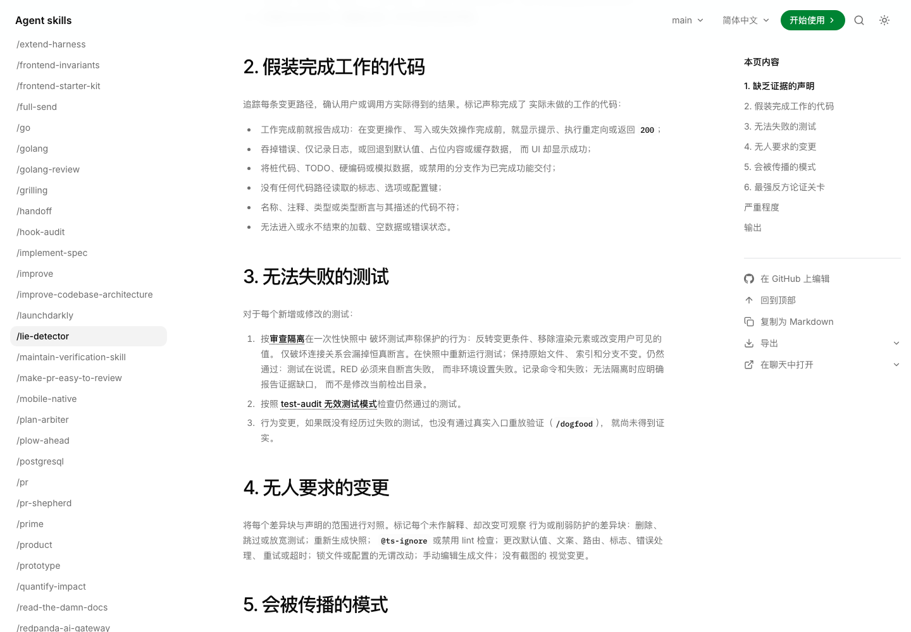
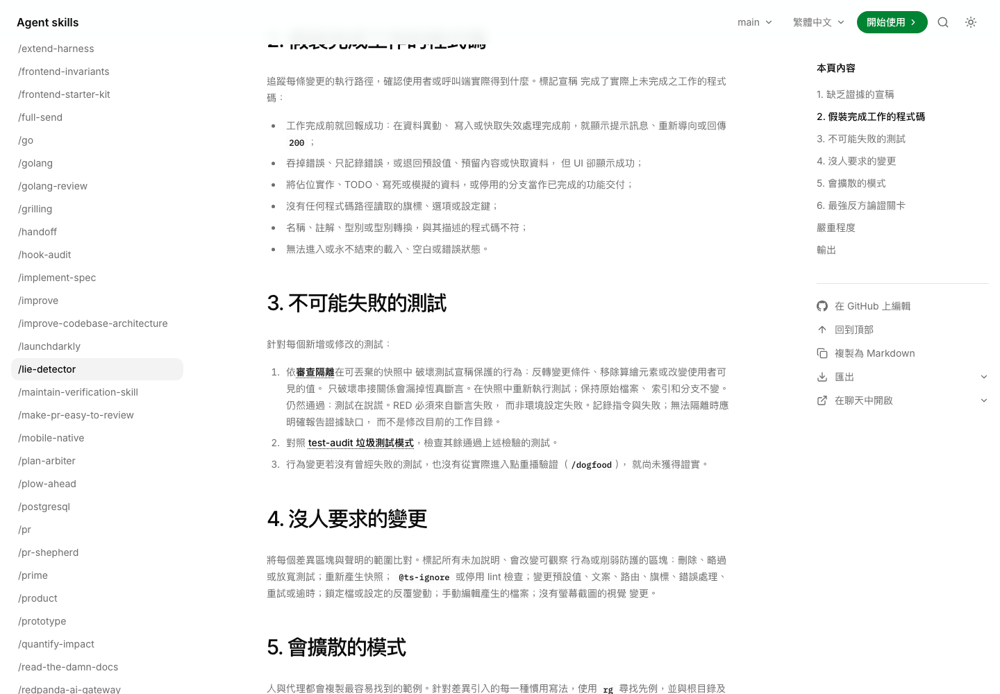

# PR 237 visual verification

Current base: `c291e60c869ea0a69926c06434d38c0ff0ac15f6`; candidate: `0aa1e5fca9c050cc74bf72bc3cf4f3ccda13f65d`.

Capture provenance: lie-detector and mutation-isolation were refreshed against actual base `a1210e0a`; their candidate pixels match the committed screenshots below. Other four skill pages and the lifecycle video retain their actual `4f579a98` / `e217ddaa` labels: later changes do not affect their rendering inputs. No reused capture is claimed as a fresh recording.

Inventory: five skills × four locales × desktop (1440×1000) and mobile (390×844) = 40 page/viewport combinations, plus four desktop mutation-isolation viewport states. Browser locale en-US; macOS Chromium, light theme, reduced motion, fixture speech voices and normalized date. The lifecycle video uses matched dark-mode browsers without the voice fixture.

Normal native run: 52 cases pass without snapshot-update flags. There are 44 changed-page assertions (40 unique combinations plus four existing duplicates) and eight author/review cases with four assertions each, for 76 screenshot assertions. Command: `BLUME_PREVIEW_PORT=4332 bun run docs:test:browser agent-check-loop.spec.ts matt-v1-3.spec.ts visual.spec.ts author-review-workflows.spec.ts --grep "agent check loop|development-lifecycle|author and review" --reporter=../shared/reporters/playwright-llm-reporter.ts`.

For the latest overlapping review rebase, the untouched a1210e0a baseline passed all 16 focused cases normally. The candidate first produced 12 intended screenshot mismatches (eight lie-detector full pages and four desktop mutation-isolation viewports), while four mobile author/review cases passed unchanged. All twelve updates were visually inspected, then the complete scoped 52-case run passed normally. The isolated mutation-test instructions remain unchanged. Earlier stale lifecycle goldens were replaced using output actually rendered from the baseline, never passed off as true prior output.

Meaningful deltas: per-edit-batch checks retain final gates; assertion review preserves type evidence; improve links an evidence-backed check-loop audit; lie-detector names compiler/CI bypass and trusted-proof limits; writing-for-agents separates deterministic enforcement from prose. Three locale mirrors and Blume metadata are synchronized.

No shared component, stylesheet, route mechanism, token, font, icon or dependency changes. Existing interactions are exercised, not redesigned. This is scoped instruction/rendering evidence, not a model-compliance benchmark or measured speedup.

## Full-view before / after / difference

Before/difference WebPs are lossless and decoded-pixel checked against PNG captures. Candidate PNGs reuse committed SHA-pinned snapshots. Black difference pixels are unchanged; insertion-related reflow is expected. Click for original size.

| Surface | Previous | New | Difference |
|---|---|---|---|
| frontend-invariants-en-desktop |  |  |  |
| frontend-invariants-en-mobile |  |  |  |
| frontend-invariants-pl-desktop |  |  |  |
| frontend-invariants-pl-mobile |  |  |  |
| frontend-invariants-zh-CN-desktop |  |  |  |
| frontend-invariants-zh-CN-mobile |  |  |  |
| frontend-invariants-zh-TW-desktop |  |  |  |
| frontend-invariants-zh-TW-mobile |  |  |  |
| improve-en-desktop |  |  |  |
| improve-en-mobile |  |  |  |
| improve-pl-desktop |  |  |  |
| improve-pl-mobile |  |  |  |
| improve-zh-CN-desktop |  |  |  |
| improve-zh-CN-mobile |  |  |  |
| improve-zh-TW-desktop |  |  |  |
| improve-zh-TW-mobile |  |  |  |
| lie-detector-en-desktop |  |  |  |
| lie-detector-en-mobile |  |  |  |
| lie-detector-pl-desktop |  |  |  |
| lie-detector-pl-mobile |  |  |  |
| lie-detector-zh-CN-desktop |  |  |  |
| lie-detector-zh-CN-mobile |  |  |  |
| lie-detector-zh-TW-desktop |  |  |  |
| lie-detector-zh-TW-mobile |  |  |  |
| writing-for-agents-en-desktop |  |  |  |
| writing-for-agents-en-mobile |  |  |  |
| writing-for-agents-pl-desktop |  |  |  |
| writing-for-agents-pl-mobile |  |  |  |
| writing-for-agents-zh-CN-desktop |  |  |  |
| writing-for-agents-zh-CN-mobile |  |  |  |
| writing-for-agents-zh-TW-desktop |  |  |  |
| writing-for-agents-zh-TW-mobile |  |  |  |
| skills-development-lifecycle-desktop |  |  |  |
| skills-development-lifecycle-mobile |  |  |  |
| pl-skills-development-lifecycle-desktop |  |  |  |
| pl-skills-development-lifecycle-mobile |  |  |  |
| zh-CN-skills-development-lifecycle-desktop |  |  |  |
| zh-CN-skills-development-lifecycle-mobile |  |  |  |
| zh-TW-skills-development-lifecycle-desktop |  |  |  |
| zh-TW-skills-development-lifecycle-mobile |  |  |  |
| mutation-isolation-en-desktop-light |  |  |  |
| mutation-isolation-pl-desktop-light |  |  |  |
| mutation-isolation-zh-CN-desktop-light |  |  |  |
| mutation-isolation-zh-TW-desktop-light |  |  |  |

## Full-view source recordings

[Previous](./current-before.webm) · [New](./current-after.webm)

The PR embeds the captioned, cursor-visible native MP4; these are uncropped source context, not substitute players.
