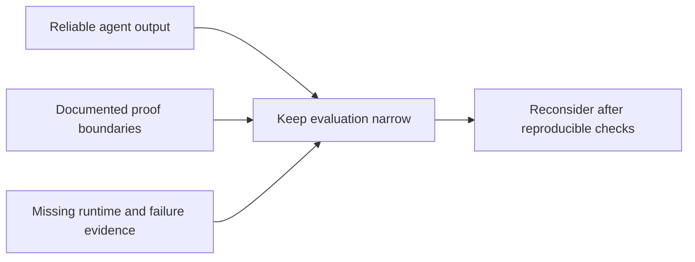

# Bend as a language for agents

**Date:** 2026-10-27

**Status:** Draft assessment; no change to language defaults or proof policy

## Recommendation

Treat Bend as an experimental candidate, not an established production replacement.
Its proof-oriented design warrants evaluation, but this review does not establish
Rust-equivalent performance, Go-like simplicity, or end-to-end correctness.
Prefer a small trusted core, useful guarantees, and fast feedback over strictness
alone. This note helps harness maintainers separate documented mechanisms from
adoption evidence. It changes no skills, hooks, dependencies, or CI requirements.

## What the desired language must demonstrate

These are proposed evaluation criteria, not findings about Rust, Go, or Bend:

- **Runtime performance:** compare equivalent programs, outputs, hardware, and
  resource limits. Report sequential and parallel results separately. Include
  verification time in the agent feedback loop, not in runtime speed claims.
- **Small design space:** measure whether agents converge on consistent designs
  with few repairs. Short syntax alone does not establish a small semantic surface.
- **Useful verification:** reject deliberately incorrect implementations while
  accepting valid ones. Measure checking cost and recovery from diagnostics.
  Identify every assumption between the written requirement and the executable.

## What Bend documents

The [project website](https://bend-lang.com/) advertises near-C sequential speed,
parallel CPU/GPU execution, and proof checking. These are upstream claims, not
measurements reproduced here. They do not establish parity with Rust on a
representative workload.

The guide makes three relevant design choices explicit:

- [Types and functions](https://github.com/bendlang/bend/blob/dd7d74db7b9e493c33eaf1d7c7f5add70636e3cb/guide/GUIDE.md#types-and-functions):
  little inference and more annotations. This moves work toward the producer,
  but the claimed checking advantage remains unmeasured here.
- [Laws and proofs](https://github.com/bendlang/bend/blob/dd7d74db7b9e493c33eaf1d7c7f5add70636e3cb/guide/GUIDE.md#laws-and-proofs):
  humans own `LAWS.bend`; agents supply implementations and `PROOF.bend`.
  The language has no proof tactics.
- [Parallelism](https://github.com/bendlang/bend/blob/dd7d74db7b9e493c33eaf1d7c7f5add70636e3cb/guide/GUIDE.md#parallelism):
  the scheduler needs balanced work. Parallel syntax alone does not guarantee
  useful acceleration.

## Where the proof guarantee stops

The [verification documentation](https://github.com/bendlang/bend/blob/dd7d74db7b9e493c33eaf1d7c7f5add70636e3cb/guide/GUIDE.md#laws-and-proofs)
describes `bend PROOF.bend --verdict` as checking with both Bend and a small
kernel backed by a Lean proof. It excludes dependencies on unsafe or foreign
code outside Base. The guide explicitly says the translation read by that kernel
has no proof. This review did not audit the kernel, translation, compiler, or
runtime.

**Assessment:** this is a documented trust boundary, not evidence that the
translation is incorrect. A kernel result does not by itself establish that the
original requirement, translated proposition, and shipped executable all agree.
Likewise, a proof of incomplete requirements cannot establish unstated behavior.
For example, a sorting requirement that checks only ordering can accept an empty
result unless it also requires preservation of the input elements.

Protecting specifications therefore matters as much as generating proofs.
Requirement changes need explicit ownership rather than automatic weakening after
a failed check. The existing [Bend laws skill](../bend-laws/SKILL.md) already
defines a model-to-shipped-code workflow. This note neither audits nor expands it.

## What the playground report establishes

A playground failure after a few prompts was reported, but no prompts, generated
program, error output, or version were supplied. It was not reproduced here.
The report does not establish the failure's cause or severity:

- A playground crash concerns availability and recovery.
- An incorrect generated program concerns agent output and verification coverage.
- Acceptance of a false proposition concerns proof soundness and needs a minimal
  counterexample under stated assumptions.

Do not label the anecdote a demonstrated soundness failure. The absence of a
reproduction is also not evidence of production readiness.

## Evidence required before broader adoption

The following checks are proposed, not completed:

1. Preserve and minimize the playground failure, with exact input, version, output,
   and recovery steps. Keep private code out of hosted prompts.
2. Pin a compiler build and run valid proofs, false laws, unfinished proofs, and
   unsafe dependencies. Record diagnostics and process exit status for each case.
3. Mutate an implementation while leaving its laws unchanged. Confirm rejection,
   restore it, and confirm acceptance through the same check command.
4. Compare generated executables with independent behavioral tests, including
   invalid inputs and failure recovery. Record assumptions outside the proof.
5. Compare representative Rust and Bend workloads under matched conditions.
   Evaluate design consistency across agent tasks separately from runtime speed.

**Revisit when:** these checks provide reproducible evidence for a specific
workload and its failure modes. Until then, production suitability remains
unestablished, rather than disproved by the playground anecdote.

## Source and verification scope

This assessment reads the public website and the
[guide pinned to upstream commit `dd7d74db`](https://github.com/bendlang/bend/blob/dd7d74db7b9e493c33eaf1d7c7f5add70636e3cb/guide/GUIDE.md).
The website is mutable. No Bend program, benchmark, playground reproduction, or
formal soundness audit was run. Repository lint, type, and link checks validate
the documentation change, not Bend's correctness or performance.
