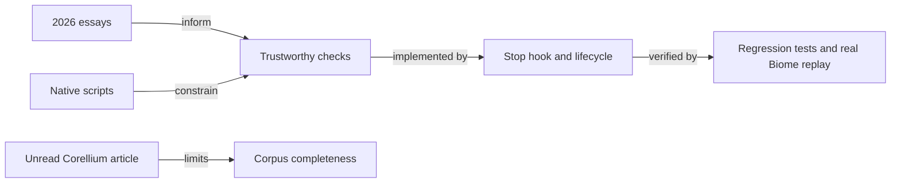

# Hayden Bleasel writing: harness decisions

Reviewed October 21, 2026. Status: implementation proposal, not a claim of production adoption.

## Decision

Strengthen the existing verification loop, not the toolchain. The newest essays favor
explicit defaults, deterministic feedback, conservative repair, and independently checked
failures. This change repairs a reproduced Stop-hook gap and adds focused operating guidance.
It does not install Ultracite/Oxc, add agents, or claim a speedup. The public index is bounded:
33 of 34 article/spec entries were readable; Corellium was unavailable. Two course overviews
were read separately, not their lessons. Reviewer focus: script compatibility and failure visibility.

## Coverage and weighting

The [live writing index](https://haydenbleasel.com/writing) contained eight personal posts,
26 external article/spec entries, and two courses. The direct HTML included
[The default wins](https://haydenbleasel.com/writing/defaults), dated October 16, absent
from the web tool's older cached index. The ledger below preserves every index entry.
Bounded author/title searches found no additional confirmed authored articles. This is
not proof that deleted, unindexed, or privately published writing never existed.
Sitemap and robots requests returned 403. Search results and maintenance pages were not
counted as full article reads.

**Selection heuristic, not measured authority:** recency weight is
`2 ** (publication_year - 2026)`: 2026 = 1, 2025 = 0.5, 2024 = 0.25,
2023 = 0.125, 2022 = 0.0625, 2017 = 0.001953125. Multiply by applicability:
3 = directly about harness operation, 2 = transferable architecture, 1 = product/design
context, 0 = unavailable. Use publisher dates where available and index
years otherwise. No 2024 article appears in this index; no source was invented to fill that year.
Scores prioritize attention, not automatic adoption. Correlated announcements are not
independent votes. A current, concrete repository contract outranks an essay regardless of score.

The four October essays therefore lead the decision. Older announcements support them
only where the current harness has a demonstrated gap. For example, the 2025 renderer
announcement advertises faster internals, while the 2026 retrospective attributes its
important gain to avoiding repeated work. That does not establish a speedup for this harness.

## Changes and existing coverage

| Decision | Existing evidence or gap | Implementation and proof |
|---|---|---|
| Honor native file checks | The root package exposes `check:files`, but the Stop hook required `lint:file`. | Both shipped hook copies prefer `check:files`; the regression changes from exit 0 to exit 2 on a failed checker. |
| Preserve failures without regex interpretation | The old path could discard unsuccessful checker output without matching source coordinates. | Final checker status determines pass/fail; legacy Biome warnings remain errors via its native flag, not text parsing. |
| Bound automatic work and repairs | Path splitting, generated files, and session ownership affect safe automation. | Separate path arguments; session/package filtering; generated and symlink exclusions; tracked-session legacy fixer followed by read-only verification. |
| Protect verification policy | A green result can be manufactured by weakening its verifier. | [Check-loop contract](../shared/check-loop.md), loaded by [shared author delivery](../shared/delivery-workflow.md). Guidance, not a tamper-proof boundary. |
| Retain independent counterexamples | Generated examples are not an independent oracle. | Checker process-contract tests and a real installed Biome replay; parser/stream fixture advice stays conditional. |
| Keep defaults explicit and replaceable | Project scripts, UI ownership, host adapters, and permission boundaries already have owners. | Reuse [repo navigation](../shared/repo-navigation.md), [hook protocol](../shared/hook-protocol.ts), [test guidance](../tdd/PROPERTY-BASED-TESTING.md), and [rule policy](../hooks/rule-policy.json), rather than adding parallel systems. |

The new checks run at **Stop**, through the existing dispatcher in both hook hosts.
This is not an automatic per-edit type/test runner. Lifecycle guidance calls for focused
feedback after material edits; full required project checks still precede delivery.
No hosted permissions, review requirements, model routing, or default stack changes.

## Rejected transfers

- Do not replace Biome with Oxc merely because the author reported a successful migration.
  No local comparative benchmark establishes that benefit.
- Do not import every strict rule. The recent loop essay rejects noisy arbitrary limits;
  existing [rule policy](../hooks/rule-policy.json) remains the owner of severity and retirement.
- Do not generalize optional-integration fallback into a successful skipped check. Required
  verification and authorization errors remain failures.
- Do not generalize Markdown repair into repairing arbitrary configuration, permissions,
  tool calls, or executable model output. Preserve source input and validate at trust boundaries.
- Do not copy framework snippets over local React Compiler, type-safety, or accessibility
  rules. The component specification includes simplified examples, not production proofs.
- Do not add a new skill, adapter framework, persistent agent, or renderer without a caller.
  Existing guidance and executable hooks provide the required reach.

## Reading ledger

`A` is applicability; `W` is recency * applicability. "Read" means the article body,
not only a title or search snippet. Course overview and inaccessible content are explicit.

| Publication | Source | Status | A | W | Finding and disposition |
|---|---|---|---:|---:|---|
| 2026 | [The default wins](https://haydenbleasel.com/writing/defaults) | Read | 3 | 3 | Agents imitate repository defaults. Keep defaults explicit and overridable; reuse local scripts rather than importing a new toolchain. |
| 2026 | [The agentic development loop](https://haydenbleasel.com/writing/ultracite) | Read | 3 | 3 | Put deterministic checks in the edit/recheck loop. Adopt exit-status enforcement; do not copy arbitrary rules or reported speedups. |
| 2026 | [Self-healing Markdown](https://haydenbleasel.com/writing/remend) | Read | 3 | 3 | Repairs need context and an independent oracle. Keep replay fixtures; reject ambiguous or security-sensitive repairs. |
| 2026 | [Building Streamdown](https://haydenbleasel.com/writing/streamdown) | Read | 3 | 3 | Avoid repeated work, isolate intricate behavior, and distrust model output. Preserve the shared host adapter and security boundaries. |
| 2023 | [Neutral is shutting down](https://haydenbleasel.com/writing/neutral) | Read | 1 | 0.125 | Retire an unsustainable service responsibly. No harness change; existing endpoint/ownership rules cover the transferable concern. |
| 2023 | [From product designer to agency director](https://haydenbleasel.com/writing/jellypepper) | Read | 1 | 0.125 | Narrow scope and automate repeatable operations before adding coordination. Already covered by the execution contract. |
| 2023 | [Refraction has been acquired by Twistag](https://haydenbleasel.com/writing/refraction) | Read | 1 | 0.125 | Customer feedback drove a small tool into a product. Retain outcome-driven development; no new integration justified. |
| 2017 | [The story of Presumi](https://haydenbleasel.com/writing/presumi) | Read | 1 | 0.00195312 | Adoption and live experiments matter more than hypothetical demand. Existing product/impact skills own this concern. |
| 2026 | [Streamdown 2.5 is now available](https://vercel.com/changelog/streamdown-2-5) | Read | 2 | 2 | Conservative parser defaults, stable completed blocks, and fallback rendering. Reinforces bounded repair; no renderer dependency needed. |
| 2026 | [next-forge 6 is now available](https://vercel.com/changelog/next-forge-6) | Read | 2 | 2 | Repository-specific agent guidance and optional integrations. Reuse the native script contract; never hide required-check failures. |
| 2026 | [AI Elements 1.9 is now available](https://vercel.com/changelog/ai-elements-1-9) | Read | 2 | 2 | Task-specific skills, partial JSX previews, and screenshots. Existing skill/visual evidence flows suffice; do not execute generated JSX blindly. |
| 2026 | [Vercel Flags are now optimized for agents](https://vercel.com/changelog/vercel-flags-are-now-optimized-for-agents) | Read | 2 | 2 | A CLI underlies the skill; adapters retain provider choice. Existing CLI-first policy suffices; keep the current flag provider. |
| 2026 | [Chat SDK adds WhatsApp adapter support](https://vercel.com/changelog/chat-sdk-adds-whatsapp-adapter-support) | Read | 2 | 2 | Adapter capabilities differ, including missing history/edit/delete. Preserve explicit capability limits; no chat integration is requested. |
| 2026 | [Chat SDK adds PostgreSQL state adapter](https://vercel.com/changelog/chat-sdk-adds-postgresql-state-adapter) | Read | 2 | 2 | Reuse existing PostgreSQL for persistent state. No new state backend needed for this stateless check repair. |
| 2026 | [Chat SDK now has an adapter directory](https://vercel.com/changelog/chat-sdk-adapter-directory) | Read | 2 | 2 | Distinguish official, vendor, and community adapters. Existing source provenance policy covers adoption; no new catalog needed. |
| 2026 | [Chat SDK adds table rendering and streaming markdown](https://vercel.com/changelog/chat-sdk-adds-table-rendering-and-streaming-markdown) | Read | 2 | 2 | Normalize intermediate streaming output at an adapter boundary. Keep the existing shared hook protocol rather than duplicating host logic. |
| 2026 | [Streamdown 2.4: More customization, accessibility and custom rendering](https://vercel.com/changelog/streamdown-2-4) | Read | 2 | 2 | Internationalization, focus/escape behavior, and configurable rendering. Existing accessibility and registry guidance already covers this. |
| 2026 | [Chat SDK adds Telegram adapter support](https://vercel.com/changelog/chat-sdk-adds-telegram-adapter-support) | Read | 2 | 2 | Telegram caching and payload/modal limitations are explicit. Useful adapter lesson, not a reason to claim host capability parity. |
| 2026 | [Introducing npm i chat - One codebase, every chat platform](https://vercel.com/changelog/chat-sdk) | Read | 2 | 2 | Shared typed core with platform/state adapters. Existing shared protocol and dispatchers already implement this architectural direction. |
| 2026 | [Streamdown 2.3 - Refreshed design and interactive playground](https://vercel.com/changelog/streamdown-2-3) | Read | 2 | 2 | A playground accelerates feedback; early plain-text output reduces waiting. Use real consumer replay instead of adding a playground. |
| 2026 | [AI Code Elements](https://vercel.com/changelog/ai-code-elements) | Read | 1 | 1 | Composable displays for agent configuration, tools, code, and results. No visual coding surface is being built. |
| 2026 | [AI Voice Elements](https://vercel.com/changelog/ai-voice-elements) | Read | 1 | 1 | Voice components with browser-specific fallback paths. Not applicable to the current harness entrypoints. |
| 2026 | [Streamdown v2: Smaller bundle size and new Remend options](https://vercel.com/changelog/streamdown-v2) | Read | 2 | 2 | Optional plugins reduce default payload and expose repair controls. Keep one small shared reference, not another always-loaded skill. |
| 2025 | [Workflow Builder: Build your own workflow automation platform](https://vercel.com/blog/workflow-builder-build-your-own-workflow-automation-platform) | Read | 1 | 0.5 | Visual workflows compile to an executable runtime. No workflow engine or persistent automation is justified by this task. |
| 2025 | [Introducing Platform Elements](https://vercel.com/changelog/introducing-platform-elements) | Read | 1 | 0.5 | Reusable domain/deploy/ownership UI blocks. Existing UI registry workflow owns these; no platform deployment changes. |
| 2025 | [Introducing Vercel for Platforms](https://vercel.com/changelog/introducing-vercel-for-platforms) | Read | 1 | 0.5 | Separate shared-tenancy and isolated-project deployment models. Existing worktree isolation remains; no hosting changes. |
| 2025 | [New npm package for automatic recovery of broken streaming markdown](https://vercel.com/changelog/new-npm-package-for-automatic-recovery-of-broken-streaming-markdown) | Read | 2 | 1 | Extract reusable repair logic behind a small preprocessing contract. Keep independently checked fixtures; avoid speculative extraction. |
| 2025 | [Streamdown 1.6 is now available to run faster and ship less code](https://vercel.com/changelog/streamdown-1-6-is-now-available-to-run-faster-and-ship-less-code) | Read | 2 | 1 | Lazy-load optional features and cache completed work. No linter replacement or performance claim without a local benchmark. |
| 2025 | [Streamdown 2.2 - animated streaming and better support for custom HTML](https://vercel.com/changelog/streamdown-2-2) | Read | 2 | 1 | Incremental rendering and explicit HTML allowlists. Preserve untrusted-input handling; do not infer sanitization from rendering success. |
| 2025 | [Introducing Streamdown: Open source Markdown for AI streaming](https://vercel.com/changelog/introducing-streamdown) | Read | 2 | 1 | Streaming rendering and restricted resource handling are first-class. Current task needs neither a renderer nor runtime-loaded code. |
| 2025 | [Introducing AI Elements: Prebuilt, composable AI SDK components](https://vercel.com/changelog/introducing-ai-elements) | Read | 2 | 1 | AI SDK state with copyable interface components. Reuse existing UI and server-state ownership; no wholesale stack adoption. |
| 2025 | [components.build](https://www.components.build/) | Read | 2 | 1 | Composable source-owned UI primitives. Retain local UI ownership, accessibility, tokens, and package policies; do not copy examples wholesale. |
| 2023 | [A Brief Look at the New Corellium](https://www.corellium.com/blog/a-brief-look-at-the-new-corellium) | Unavailable | 0 | 0 | Unread: publisher returned a maintenance shell; web retrieval returned 403. Excluded from conclusions. |
| 2022 | [Redesigning ESLint](https://eslint.org/blog/2022/08/redesigning-eslint/) | Read | 1 | 0.0625 | Readable, navigable docs and a reproducible playground. Historical context, not evidence to migrate back to ESLint. |
| 2025 | [Production Monorepos with Turborepo](https://vercel.com/academy/production-monorepos) | Overview only | 1 | 0.5 | Course overview only: shared packages, test caching, and measured builds. Lessons are not claimed as read articles. |
| 2025 | [React UI with shadcn/ui + Radix + Tailwind](https://vercel.com/academy/shadcn-ui) | Overview only | 1 | 0.5 | Course overview only: accessible primitives and source ownership. Lessons are not claimed as read articles. |

The component-spec entry is a living coauthored specification, not a dated essay; its
2025 index year is the weighting input. Supplementary sections consulted cover terminology,
composition, accessibility, tokens, state, styling, types, polymorphism, slots, documentation,
and distribution. These examples are context, not adopted code. Course lesson bodies,
videos, and arbitrary recursively linked product documentation are outside the article corpus.
The Streamdown 2.2 publisher page displays September 8, 2025, despite chronology that merits
caution; no implementation decision depends on that release date or its API snippets.

## Verification and limits

- `bun test ./scripts/biome-stop.test.ts`: process-contract regressions against both the
  installed hook and copyable starter hook. The initial failure case was observed on the
  pre-change hook before implementation.
- Real consumer replay with installed Biome 2.5.9: the old hook passes a broken file in a
  `check:files`-only project; the new hook blocks, then passes after repair. Invalid Biome
  configuration blocks; the legacy safe-fixer/read-only-check path remains runnable.
  Without ownership tracking, a malformed file blocks without being edited, then passes
  after explicit repair. A legacy warning also blocks and passes after correction.
- The suite owns argument transport, script precedence, failed invocation visibility,
  untracked/session isolation, missing ownership tracking, package scope, generated assets, and symlinks. It does not
  prove arbitrary consumer scripts correctly lint their inputs, nor prevent an agent
  from editing verification policy.
- No cross-model quality, throughput, latency, or token improvement is claimed. The new
  read-only default can require an extra repair turn compared with automatic fixing.
  It intentionally preserves consumer choice and avoids unsolicited edits.
- Corellium's canonical URL, AMP variant, and alternate hostname returned maintenance
  content; the web tool returned 403. Its unread body contributes no recommendation.
  Revisit if a complete public primary-source copy becomes available.
