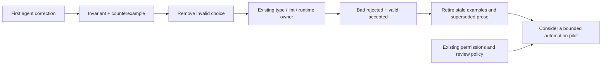

# Lauren Tan: corrections that change the environment

**Decision:** adopt a first-correction loop in the existing harness owners, not a new
skill, model mode or automation service. The operational owner is the
[correction tree](../shared/POTETO-NATIVE.md#harness-improvement).

**Sources:** the supplied [short URL](https://t.co/Fel7tlxqSL) redirects to
[All Code Is Slop (Except Mine)](https://www.youtube.com/watch?v=O_zcc6Xl12g),
published by AI Engineer on November 14, 2026. The
[conference session](https://ai.engineer/code/2026/talks/lauren-tan) is dated November 11.
The supplied image is a visual summary, not a transcript or harness policy.

## Timestamped source notes

Times below use the **17:31 standalone clip**, not the conference livestream clock.
These are paraphrases, not a verbatim transcript.

| Clip | Method |
| --- | --- |
| [02:03-03:25](https://www.youtube.com/watch?v=O_zcc6Xl12g&t=123s) | Invest first in code/API constraints and deterministic checks, then verification, then prose for judgment. Treat corrections as opportunities to improve that environment. |
| [04:25-06:51](https://www.youtube.com/watch?v=O_zcc6Xl12g&t=265s) | Agents copy existing patterns. Remove bad examples; enforce architectural seams. Dune's effect restrictions and Electron import boundaries are examples of local policy. |
| [06:57-09:38](https://www.youtube.com/watch?v=O_zcc6Xl12g&t=417s) | Workaround comments can preserve bad choices. Prefer a supported API or an actionable check over repeated explanations or overgeneralized rules. |
| [09:41-13:17](https://www.youtube.com/watch?v=O_zcc6Xl12g&t=581s) | Runtime drivers and user-facing feature maps make behavior inspectable. Formal models and property-based testing add evidence, not a silver bullet. |
| [15:11-16:54](https://www.youtube.com/watch?v=O_zcc6Xl12g&t=911s) | Improve the inner coding loop before automating the outer loop. Her team's reported throughput does not establish results for this harness or grant merge authority. |

### Transcription provenance and limits

The existing local video-research entrypoint ingested the complete clip on November 16.
Native English captions returned HTTP 429; the pinned local MLX Whisper adapter produced
275 timestamped segments instead. Raw ASR, OCR and sampled frames remain temporary
research inputs, not redistributed talk text. ASR misrecognizes names and technical words;
the notes use the clip description, source recording and conference context to disambiguate.
Scene sampling concentrated on the property-testing demonstration, so it is not evidence
that every slide was inspected. No cloud speech service, browser cookies or paid API was used.

## Intent map

## Integration and coverage

At the original November 16 research baseline (`91312230`), the registration inventory
contained **118 local owners** and **139 explicit source adapters**. This is a routing inventory, not a claim of reviewing every
skill's effectiveness. The initial integration reached 21 existing native owners;
`vendor-poteto.py --check-routing` checks source coverage, targets and reciprocal links,
not model adherence.

| Task family | Decision and owning surface |
| --- | --- |
| Implementation and delivery | Existing `execution` consumers (`development-lifecycle`, `commit-push-pr`) select the correction tree before repairing a mistake. Root instructions point to the same owner. |
| Architecture and domain | The four `design` owners choose the invariant's owning API/type/state seam; the curated engineering rule no longer waits for a second occurrence. |
| Verification | Seven `verification` owners reuse the same decision tree instead of automatically adding another test. Existing verifier generation/maintenance already own feature maps, drivers, cold launch, cleanup and evidence gaps. |
| Diagnosis and review | Both `review and diagnosis` owners share the tree. `resolve-pr-feedback` records the chosen layer and proof in its existing reply rather than creating a correction ledger. |
| Harness learning | `writing-for-agents`, `hook-audit`, `extend-harness` and `retro` route the first correction to an effective mechanism. Reflection remains read-only until edits are authorized. |
| Automation planning | `software-factory` requires an observed bad/valid control and replayable verification before recommending scale. A successful pilot is not authorization to schedule, delegate, deploy or merge. |
| Preferences and domain skills | Existing scoped preference/evidence rules remain. No blanket `useEffect`, timer or comment ban; local design constraints need their own demonstrated contract. |
| Source adapters | Compatibility owners remain authoritative. No upstream snapshots, registrations, model routes or delegation permissions change. |

## Executed correction: missing transcript reported as success

**Counterexample:** the video analyzer returns whitespace-only or non-text speech segments, a failed
speech-recognition warning and readable slide OCR. The wrapper previously returned zero
with empty or invalid `transcript.txt` content, although the user requested transcription.

**Owner and mechanism:** change the existing CLI's completion contract, not another
instruction telling agents to remember to inspect file length. Speech is required by
default. Genuine silent-media research opts into `--visual-only`, which needs OCR or
frame files and labels its evidence mode. Neither path treats zero evidence as success.
Warnings and partial artifacts survive failure for diagnosis. Cloud keys stay disabled.

**Proof:** the public `video-research` eval fails on the prior wrapper (missing transcript
accepted with exit zero), then passes after the repair. Valid speech remains accepted;
OCR-only input requires explicit visual mode, and empty visual output fails. Non-text
objects cannot count as speech. This is one
concrete contract improvement, not a measured reduction in future model errors.

**Limits:** runtime assertions cannot decide whether a transcript accurately captures intent,
whether every model will consult the tree, or whether autonomous merging is safe. Keep
human judgment and hosted approval requirements; evaluate future mistakes at their actual
owner instead of accumulating prose or relying on this example alone.
