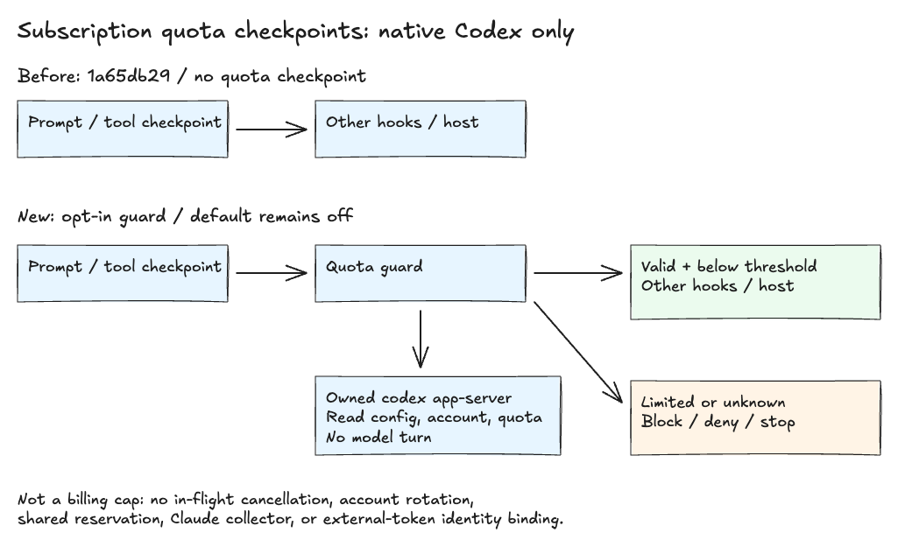

# Subscription quota guard

Source review: 2026-10-30.

The harness can block new prompts and task launches, and stop further work at
post-tool checkpoints, when native Codex allowance reaches a configured threshold.
It reads actual quota windows instead of estimating usage from token counts.
The guard is opt-in and does not use CLIProxyAPI, rotate accounts, or select a
paid fallback. It is a safety buffer, not a zero-overage billing guarantee.



[Editable architecture](architecture/subscription-quota-guard.excalidraw). The before
view reflects `skill-manifest.json` at `1a65db29`; the new path follows
[`scripts/quota-guard.py`](../scripts/quota-guard.py) and its generated hook registration.
Verified through the real shell hook, protocol fixtures, and read-only native metadata.

## Enable for native Codex

Requires Python 3 and the native `codex` CLI on `PATH` in the hook environment.
Enable and trust the installed hooks in your host, then set these variables on the
Codex process before starting a session:

```sh
HARNESS_QUOTA_GUARD=1 \
HARNESS_QUOTA_GUARD_ACCOUNT='your-account@example.com' \
HARNESS_QUOTA_GUARD_THRESHOLD=90 \
codex
```

Use the email of the native ChatGPT login in that process's `CODEX_HOME`. The guard
requires a matching account before and after reading quota. It rejects API-key
authentication, custom providers, endpoint overrides, and missing account identity.
It does not print your email, parse credential files, start a model turn, change
models, or lower reasoning effort.

The default threshold is 90 percent. You can select a value from 1 through 99.
The collector has a five-second total deadline, configurable from 0.1 through 10
seconds with `HARNESS_QUOTA_GUARD_TIMEOUT`. It terminates its own collector process
when finished. It installs no daemon and changes no account or billing settings.

To disable it for a subsequent session, omit `HARNESS_QUOTA_GUARD` or set it to `0`.
Changing environment variables in a tool's child shell does not change the running
host's environment. Restart the host with the intended settings.

## What the hooks enforce

| Checkpoint | Below threshold with valid readings | Limited or unavailable |
| --- | --- | --- |
| `UserPromptSubmit` | Allow the prompt | Block the prompt |
| `PreToolUse` for `Agent`, `Task`, `spawn_agent`, and matching MCP delegation tools | Allow the requested launch | Deny that tool call |
| `PostToolUse` | Allow further work | Return `continue: false` to stop the turn |

A denied launch does not necessarily stop the parent model. The post-tool hook is
an additional checkpoint, not an interrupt inside an already-running model request.
The guard is deliberately not wired to `Stop`: blocking that event would make the
agent continue instead of saving allowance.

Every check starts an owned `codex app-server` process and uses read-only
`config/read`, `account/read`, and `account/rateLimits/read` requests. It checks
all reported primary, secondary, and model-bucket windows conservatively. An absent
secondary window is not invented. A missing set of windows, malformed response,
expired reset timestamp, account mismatch, collector error, or timeout blocks work.
There is no cached percentage that can silently become fresh or reset to zero.
See the [official app-server protocol](https://learn.chatgpt.com/docs/app-server).

Both local and plugin hook configurations are generated from `skill-manifest.json`.
The host must execute and honor those hooks. Supported output contracts are
specified in the [Codex hooks reference](https://learn.chatgpt.com/docs/hooks).
Disabled mode exits before starting Python or contacting a provider.

## Current support boundaries

**Claude is not supported by this first collector.** With the guard enabled, its
hooks block with an explicit unsupported message. Claude's documented status-line
quota data appears only after an API response; treating an absent reading as unused
allowance would defeat fail-closed startup. No private OAuth endpoint or synthetic
usage estimate is substituted. See [Claude's native quota data](https://code.claude.com/docs/en/statusline#rate-limit-usage).

For T3 Code, this checks only the native CLI login inherited through `CODEX_HOME`.
It cannot establish the billing identity of a separate partner-token connection,
intercept T3's transport, or govern another machine/session. Do not treat a reading
from a different native CLI login as evidence about a T3 account.

The collector resolves configuration on disk, not the parent host's command-line
overrides. Provider/authentication overrides through `--config` or `--profile` are
not supported. Enable the guard only when the host and collector use the same
native account and configuration. A quota check is not proof of billing identity
for an arbitrary host connection.

## Keep provider-side billing protection

The threshold leaves headroom; it cannot predict the cost of the next request.
Concurrent sessions can consume that headroom, a long request can cross it, and a
provider's reported percentage can lag. A model request already in flight can
finish before the next hook checkpoint. Cancellation cannot reverse existing usage.

Keep extra usage and credit purchases disabled at the provider. ChatGPT app-sharing
credit controls are separate from native CLI authentication and do not automatically
apply to it. Disabling auto-reload alone does not prevent spending an existing
credit balance. See [OpenAI's credit controls](https://help.openai.com/en/articles/20001542-using-your-chatgpt-plan-in-other-apps-and-sites)
and [credit behavior](https://help.openai.com/en/articles/12642688-using-credits-for-flexible-usage-in-chatgpt-personal-plans).

No live billing-transition test or promise of zero extra charges is part of this
feature. The runtime contract is blocking supported checkpoints on observed quota
or unavailable evidence, not provider-enforced spending authorization.

## Verify the installed path

Before relying on it, exercise the actual trusted hook command with a masked native
account and confirm its identity binding. Test threshold, missing-data, timeout,
wrong-account, and recovery paths without enabling paid usage. Recheck after host,
authentication, or protocol changes. Never publish tokens or raw provider responses.

Repository verification:

```sh
bun test scripts/quota-guard.test.ts
bash scripts/generate-hook-configs.sh --check
```

To roll back, disable the opt-in for the relevant host and restore the previous
harness version. Leave provider-side credit restrictions enabled. No proxy service,
shared account directory, or billing setting needs removal.
