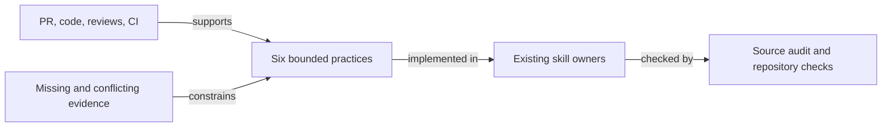

# What to learn from T3 Code's UI overhaul

**Researched:** 2026-10-26. **Status:** decision-ready research; focused guidance adopted in this draft.

## Decision

Adopt evidence-linked UI requirements, calibrated reviews, complete feedback dispositions,
auditable regression budgets, state-aware code, and user-task acceptance criteria. Keep the
existing skills as owners; add no council service, mandatory model lineup, or score target.
The beneficiaries are authors and reviewers who need to distinguish a convincing presentation
from verified behavior. The strongest lessons include counterexamples: unresolved findings,
missing screenshots, and a transfer budget that does not measure UI speed. Review the adoption
map and proposed acceptance scenarios; better review outcomes remain unmeasured.



## Scope and evidence strength

The subject is [pingdotgg/t3code#24865][pr], merged on October 25. The research pins
the final PR head to `fd8717d3e4fe071bccca56eed686b32fdf70c2da` and its final base to
`b3b2c55369ec4bb1842bd2fcdac0744a8c787b6b`. GitHub reports 17 commits and 59 changed
files, with 583 additions and 269 deletions. These are scope identifiers, not quality metrics.
The [full diff][diff] and [commit history][commits] were read alongside four superseded PRs:
[#24776][foundation], [#24837][clarity], [#24810][accent], and [#24883][toggle].

Evidence labels used below:

- **Observed:** retrieved source, public discussion, artifact contents, or inspected image.
- **Author-reported:** a process or result described by the PR author without its underlying run record.
- **Proposed:** a reusable practice or reconstructed acceptance criterion, not historical agreement.
- **Unknown:** not established by the available sources. Lack of a public record does not prove work was absent.

The research retrieved all five issue comments, five submitted reviews, five inline review
comments, and every GraphQL review thread, including outdated/resolved ones. Each thread
has one comment and no further comment page. All five submitted GitHub reviews are from
Macroscope or CodeRabbit; they are not the separate model-council sessions reported in the body.
No GitHub human approval was found in this snapshot. Merge is not evidence of one.
See [review submissions][reviews-api] and [inline comments][comments-api].

## 1. Report UI requirements as inspectable changes

### What works

The useful structure is not a long file list. The PR groups visible deltas by sidebar,
composer, details panel, settings, and theme. It separately explains which changes require
opt-in and which affect everyone. The [toggle predecessor][toggle] states the user-facing
reason: people should not reopen into a substantially different workspace without a way back.

The [annotated comparison][annotated] provides an overview with numbered arrows and local
legends. Full-resolution pairs preserve the surrounding interface. I inspected the overview,
the main/candidate dark and light thread pairs, the new-thread pair, and the settings pair.
Examples are concrete: a readable worktree icon, a two-line PR title, a denominator beside
check counts, and the history control's visible armed state. The capture description names
macOS, a 1280×832 viewport, seeded development data, and disabled development sidebar artwork.
These are controlled fixtures, not evidence from a user study.

### What to improve

- **Two comparisons answer different questions.** Main-versus-candidate shows the complete
  change. Classic-versus-new shows the switch's effect within the candidate. Neither alone
  proves the off path preserves the base, because shared fonts, tokens, radii, and copy change
  even with the switch off. The [schema][settings-source] defaults both new preferences to false;
  the [root synchronization][root-source] applies the document attribute.
- **Capture provenance is incomplete.** Names such as `s10`, `s11`, `t1`, and `t2` distinguish
  images but do not publicly map every capture to a commit. Preserve that mapping in new work.
- **Availability decays.** Nine of the 16 image URLs in the final body downloaded successfully.
  The six classic/new comparison images and the Beta-settings image returned HTTP 404
  with `curl` during this research. That establishes present unavailability, not their status
  when merged. Initial Python requests also encountered HTTP 403; a browser-like user agent
  retrieved the other images. The published body contains still images, not a flow video.
- **Platform evidence is not interchangeable.** The [foundation PR][foundation] shows Linux
  renders for the font change; the final comparison is macOS. A macOS screenshot does not
  independently prove Windows/Linux font weight behavior, keyboard access, or contrast ratios.
- **Comparable environment is not identical state.** Sidebar ordering differs between the
  main/candidate images; settings are full-page in one and a modal in the other. Those images
  help explain local changes, but an automated visual comparison needs matched state and shell.

**Adopt:** problem -> visible requirement -> annotated evidence -> acceptance check, grouped
by surface. Keep native-resolution originals, identity metadata, and a working interaction
recording under the existing [PR evidence policy](../pr/SKILL.md#evidence). Do not copy only
this PR's screenshot format and weaken the existing video requirement.

## 2. Gather reviews against a fixed packet, not a desired score

### What the public record supports

The author reports 18 rounds: initial visual refinement, a higher-score pass, then integration
review after adding the toggle. The final body identifies four model families, shows skipped
cells rather than pretending every model ran each time, and separates visual ratings from
code ratings. The [earlier clarity PR][clarity] explicitly says one reviewer's requested changes
were partially applied but its current build had not yet been rescored. That distinction is useful.

The [foundation PR][foundation] reports an apparent clipped placeholder that disappeared on
native-resolution crops; the reviewer revised its score without a code change. The final
score discussion also records reference-score drift and a narrative claiming superiority
despite exceptions in the reviewer's own comparison table. These are reasons to examine
evidence, not normalize a metric until it passes.

### What cannot be inferred

Council prompts, raw reports, task IDs, execution transcripts, independence controls,
category definitions, costs, and complete capture-to-review mappings are not attached to
the public material inspected. The body is evidence of what the author reported, not a
reproducible experiment proving cross-model agreement, superiority, or an optimal round count.
Repeated exposure and score-target prompting could affect ratings; their contribution is unknown.

**Adopt a review packet:** pinned build/diff, user task, representative states, unchanged
reference captures, rubric, owner constraints, and prior unresolved findings. Preserve actual
executor, covered categories, skips, and dissent. Judge defects with reproductions and taste
with the owner's decision. Re-review the integrated implementation after flag/theme changes;
a high earlier design score does not check CSS precedence or reset/search wiring.

**Do not adopt:** 18 rounds, a 9.5 threshold, mandatory competing-app superiority, or four
models on every change. [Review calibration](../visual-review/REFERENCE.md#review-calibration)
remains inline by default, respects existing round limits, and grants no delegation consent.

## 3. Address feedback through evidence and dispositions

### A visible product response

A [user comment][color-request] asks to retain project colors because they identify a thread's
project and status at a glance. The later [preference commit][color-commit] adds a setting,
schema field, search entry, and reset wiring. It demonstrates a better response than arguing
that a calmer palette is inherently better: preserve the person's recognition task while
keeping a different default. The timeline supports the sequence; it does not expose the
private decision process.

### Code response is not the same as hosted closure

| Finding or decision | Evidence in final code/history | Remaining qualification |
| --- | --- | --- |
| Default-off rollout | [Toggle commit][toggle-commit], schema and root attribute | Shared changes remain on; not a complete rollback to main |
| Reset and gated settings search | [Reset/search commit][reset-commit], [availability filter][search-source] | Static wiring verified; no live reset/search replay here |
| Dark PR-number and resting-height precedence | [Specificity fix][specificity-commit] adds combined variants | Council recheck is author-reported, not independently replayed |
| Explicit icon strokes lose to a default | [Feedback][stroke-comment] and [fix][error-stroke-commit] move the rule into `@layer base` | Thread resolved; runtime styles not replayed here |
| Git failure disappears as an empty draft | [Feedback][error-comment] and final `!gitStatusError` guard in [Git actions][git-source] | Thread resolved; this is a narrower fix than the suggested non-null snapshot check |
| Feature-only Previous agents row leaks into a shared primitive | [Review body][outside-review] and [refactor][row-commit] use the existing feature control | No need to adopt every suggested extraction literally |
| Brand colors, switch accent, row density and canvas | Final body lists owner constraints | Owner preference, not empirical proof of universal usability |

At research time, **three of five threads remain unresolved**: untracked work hidden by an
empty-draft predicate, truncation after widening, and the slim sidebar ignoring the color
preference. The last is outdated but still open. Two other threads are resolved. None of
the five contains an author reply. See [inline comments][comments-api], the
[untracked-work finding][untracked-comment], [truncation finding][truncate-comment], and
[slim-layout finding][slim-comment].

Source inspection supports continued concern, without substituting for reproduction:

- `quietEmptyDraft` checks disabled quick action and zero diff totals, but not
  `hasWorkingTreeChanges`. The [quick-action resolver][git-logic] disables actions for a
  detached ref before inspecting work. A disabled action is therefore not proof of emptiness.
- The slim row's early return retains unconditional inactive grayscale; only the card row
  reads `sidebarProjectIconColors` in its icon condition. See [sidebar source][sidebar-source].
- `fitHead` reads available width before clearing an existing overflow marker, while that
  marker adds an ellipsis in a nonshrinking sibling. See [truncation source][truncate-source].

The [latest CodeRabbit summary][rabbit-summary] says automatic reviews paused after
`643cb53`; its latest listed head is `fd8717d`. Macroscope's [summary][macro-summary] still
describes blocking correctness concerns. Green CI, a merged PR, an outdated line, or a
summary saying no new findings does not erase those facts.

**Adopt:** enumerate issue comments, review bodies including outside-diff findings, and all
threads. Record accepted fix + proof, rejected finding + counterexample, or unresolved
decision. Verify on the integrated head, reply, then close. Separate code disposition,
hosted thread state, and reviewer freshness. The existing
[feedback workflow](../resolve-pr-feedback/SKILL.md) owns this, not another council loop.

## 4. Benchmark performance at a named boundary

### The benchmark is real, but inherited and narrow

The standing [CI workflow][ci-source] forces the transfer-budget integration test to run
uncached, emits a structured result and a job summary, and requires an artifact when the
server tests ran. None of that infrastructure is changed in this PR's final file list.
The [posted report][transfer-comment] is useful evidence from an existing system, not a
benchmark implementation authored by this redesign.

The [fixture][fixture-source] uses synthetic histories for Codex and Claude: ten earlier turns,
five command tools and a 900,000-byte retained result per earlier turn, followed by twenty
command tools and a 1,100,000-byte result in the measured turn. The
[integration test][integration-source] exercises persistence, production HTTP/subscription
handlers, actual loopback sockets, compression, reconnect, and bounded history. It also
asserts retained content exists in storage while omitted from the small projection: fewer
bytes alone cannot establish correct behavior.

The [measurement helper][measurement-source] distinguishes encoded body, decoded body,
HTTP wire, and WebSocket wire/message counts. The [report source][budget-source] states
that HTTP wire includes response headers, while TCP/IP, TLS, upgrade, and provider adapter
ingestion are outside scope. Shell/reconnect/SQL diagnostics are informational because
batch timing can affect them. Long-turn decoded bytes and row counts have additional gates
in the detailed report; they are not all represented in the compact PR-comment artifact.

### Historical artifact audit, not a speedup claim

I downloaded both `thread-transfer-results` artifacts, decoded their JSON without executing
PR code, compared scenario and ceiling objects, recomputed totals, and checked every capped
metric. Baseline [run 40231697904][baseline-run] is at the exact final base; candidate
[run 40231884636][candidate-run] is at the final head. Both scenarios and ceilings match.

| Provider / metric | Base | Head | Ceiling |
| --- | ---: | ---: | ---: |
| Codex total wire, bytes | 5,098 | 5,098 | 7,000 |
| Codex snapshot wire, bytes | 3,879 | 3,879 | 5,000 |
| Codex live WebSocket wire, bytes | 1,219 | 1,219 | 2,000 |
| Codex live WebSocket decoded, bytes | 21,360 | 21,360 | 30,000 |
| Codex live messages | 2 | 2 | 8 |
| Claude total wire, bytes | 5,110 | 5,117 | 7,000 |
| Claude snapshot wire, bytes | 3,889 | 3,889 | 5,000 |
| Claude live WebSocket wire, bytes | 1,221 | 1,228 | 2,000 |
| Claude live WebSocket decoded, bytes | 21,710 | 21,710 | 30,000 |
| Claude live messages | 2 | 2 | 8 |

These exact values archive the audit, not quantified product impact. They establish that
the recorded fixture stayed within unchanged ceilings. The small encoded-wire difference
does not establish a meaningful regression or gain. No repeated experiment here estimates
variance. No UI rendering latency, layout cost, input responsiveness, font-bundle effect,
real-network performance, provider ingestion throughput, or customer task time is established.

### Publishing evidence safely

The separate [publisher workflow][publisher-workflow] checks out its reporter from the trusted
default branch and treats PR artifacts as data. The [publisher][publisher-source] validates
fixed keys, scenario version, providers, bounded nonnegative integers, regular files, and
file size. It prefers the exact base, labels fallback baselines and fixture/ceiling changes,
checks head freshness during resolution and immediately before publishing, and updates an
identified bot comment. [Publisher tests][publisher-tests] exercise ambiguity, missing runs,
skipped measurement, stale heads, and preservation of a same-head result.

This is a useful trust pattern, not a full security audit or tamper-proof attestation.
An author-controlled ceiling is not an independent service-level objective. Missing data is
not zero, skipped CI is not a measurement, and a green budget says nothing about visual taste.
Adopt the boundary/provenance checks in
[quantify-impact](../quantify-impact/REFERENCE.md#existing-ci-regression-budgets), without
adding a new publisher, paid service, or mandatory benchmark to this skills repository.

## 5. Write code around invariants and ownership

| Pattern inspected | Useful lesson | Qualification |
| --- | --- | --- |
| [Schema defaults/patch][settings-source], [root attribute][root-source], [search availability][search-source], reset action | Treat a setting as a whole contract: old stored data, read/write, reachability, search, reset, alternate consumers | Adding a checkbox is not feature completion; the slim-row gap is a counterexample |
| [Global tokens and redesign variant][css-source] | Prefer shared tokens and one presentation gate over separate duplicated screens | `:where()` lowers specificity but does not outrank cascade layers or more specific combined variants; inspect computed styles |
| [Feature row refactor][row-commit] | Keep single-feature semantics in the feature; reuse its existing control | Do not grow a shared primitive merely to express one panel's row |
| [Pure text split][truncate-source] and [five added tests][truncate-tests] | Isolate deterministic domain decisions: preserve useful branch suffixes, word boundaries, explicit options | Tests exercise strings, not DOM width, theme, resize, observer cleanup, or full grapheme correctness |
| `useLayoutEffect` plus [shared resize observer][resize-source] | Refit changed text even at unchanged box size; return the observer's cleanup | Synchronous range/layout reads in dense lists need browser evidence; binary search alone is no performance proof |
| Shared placeholder and labels across web/mobile/search/docs in the [diff][diff] | Update every user-facing name and discovery surface together | Static consistency is not a live cross-platform replay |

Only two test files change: five new string-split cases and one added gated-search exclusion
expectation. The latter protects the off path; it does not independently prove the enabled
setting remains reachable. The public diff/CI does not establish failing-test-first history
or rendered regression coverage for the new layout behavior. Do not infer either from a
passing aggregate test job. See [search tests][search-tests] and [candidate CI][candidate-run].

Adopt the invariant, not the upstream repository's entire stack or style. This repository's
React Compiler, shared-button policy, test seams, and existing
[frontend invariants](../frontend-invariants/SKILL.md) remain authoritative. The draft does
not copy the redesign code, add its font dependency, or present the unresolved source issues
as fixes made here.

## 6. Explain product value through end-user acceptance

The clearest supported value is preserving recognition and control while changing appearance:
the [color request][color-request] names a real recognition task, and the [rollout proposal][toggle]
names the risk of involuntary change. Reduced confusion is a plausible intended benefit,
not measured task success. No revenue, retention, adoption, or task-time result was found.

The following are **proposed, reconstructed criteria**, not claims that the original author
agreed to them or that they all pass. Each links an end-user result to a discriminating check.

| Beneficiary / task | Given / When / Then | Decisive proof and current limit |
| --- | --- | --- |
| Existing user preserving a workspace | Given old stored settings without the new key, when I reopen without opting in, then the gated sidebar/composer remain classic; shared changes are disclosed | Decode old settings, open the app, compare off path with base; false default observed, full replay absent |
| User trying a redesign reversibly | Given classic mode, when I enable New design in Settings > Beta and later turn it off or restore defaults, then gated changes follow that choice | Exercise enable, reload, disable, and reset; static wiring only |
| Color-reliant project recognition | Given New design and Colored project icons enabled, when I expand or collapse the sidebar, then inactive project icons keep their colors | Card/slim × inactive/active × hover/focus matrix; slim finding remains open |
| User discovering settings | Given classic mode, when I search for colored project icons, then I do not land on an absent control; enabling New design makes it discoverable | Off exclusion and on inclusion plus navigation to a real anchor; off expectation added, full positive path not demonstrated |
| Author recovering source-control work | Given Git status failed or a detached draft has untracked files with zero line totals, when I open details, then failures/work and a recovery path remain visible | Error and untracked fixtures, not only a clean empty draft; error guard observed, untracked finding remains open |
| Author reading long branch names | Given a long branch, when I narrow then widen the panel, then I see meaningful suffixes and recover the full label without partial glyphs | Real-browser shrink/grow/text-change replay plus Unicode cases; pure split tests do not cover the open resize finding |
| Author choosing history behavior | Given a large history, when I arm Compact next or Keep full, then the label and pressed state identify what the next send will do | Toggle via keyboard and send against actual compaction behavior; markup/state wiring observed, interaction not replayed |
| Reviewer understanding PR health | Given a long title and incomplete checks, when I open details, then I can read the wrapped title and completed/total check count | Long-title and incomplete/failure/loading fixtures in both themes; successful still captures cover only selected states |

For business-facing prose, lead with the role and task, then the visible guarantee, evidence,
and rollout limitation. A model's aesthetic rating is neither the benefit nor the acceptance
test. [Product craft](../product/CRAFT.md#acceptance-in-the-beneficiarys-words) owns this guidance.

## Adoption map and boundaries

| Requested learning | Existing owner changed | Missing behavior added |
| --- | --- | --- |
| UI reporting | [PR evidence](../pr/SKILL.md#evidence) | Surface-to-check traceability, comparison identity, partial rollback disclosure |
| Review gathering | [Visual calibration](../visual-review/REFERENCE.md#review-calibration) | Stable packet, native-resolution dispute check, score drift and coverage honesty |
| Feedback | [Feedback resolution](../resolve-pr-feedback/SKILL.md) | Outside-diff/paused coverage, stale-head distinction, preference acceptance across layouts |
| Performance | [Impact reference](../quantify-impact/REFERENCE.md#existing-ci-regression-budgets) | Existing CI budget provenance, measurement boundary, trusted publication |
| Code | [Frontend invariants](../frontend-invariants/SKILL.md) | Authoritative emptiness, feature/primitive boundary, cascade combinations |
| Product value | [Product craft](../product/CRAFT.md#acceptance-in-the-beneficiarys-words) | Role/task criteria with failure, opt-out and explicit evidence limits |

Existing TDD, video evidence, inline review, delegation consent, review-round caps, benchmark
noise filtering, and delivery endpoints remain in force. No new skill, hook, model routing,
paid integration, watcher, application implementation, or upstream mutation is introduced.
These are instruction improvements; their effect on future agent/reviewer quality needs a
separate behavioral evaluation. Content checks do not establish that effect.

## Reproduction and coverage limits

### Retrieval recipe

Use authenticated `gh` where needed. Paginate REST collections and GraphQL threads/comments;
check `hasNextPage`, not just the first screen. GitHub comments/bodies can be edited later.

```sh
gh api repos/pingdotgg/t3code/pulls/24865
for kind in commits files reviews comments; do
  gh api --paginate --slurp "repos/pingdotgg/t3code/pulls/24865/$kind?per_page=100"
done
gh api --paginate --slurp 'repos/pingdotgg/t3code/issues/24865/comments?per_page=100'
gh api --paginate --slurp 'repos/pingdotgg/t3code/issues/24865/timeline?per_page=100'
gh api graphql -f query='query {
  repository(owner:"pingdotgg", name:"t3code") {
    pullRequest(number:24865) {
      reviewThreads(first:100) {
        totalCount pageInfo { hasNextPage endCursor }
        nodes {
          path isResolved isOutdated
          comments(first:100) {
            totalCount pageInfo { hasNextPage endCursor }
            nodes { url body author { login } }
          }
        }
      }
    }
  }
}'
```

Read source through full-SHA links below, not today's main. For the historical artifact audit:

```sh
gh api repos/pingdotgg/t3code/actions/runs/40231697904/artifacts
gh api repos/pingdotgg/t3code/actions/runs/40231884636/artifacts
gh api repos/pingdotgg/t3code/actions/artifacts/12613586289/zip > /tmp/t3-base-transfer.zip
gh api repos/pingdotgg/t3code/actions/artifacts/12613003395/zip > /tmp/t3-head-transfer.zip
unzip -p /tmp/t3-base-transfer.zip thread-transfer-result.json
unzip -p /tmp/t3-head-transfer.zip thread-transfer-result.json
```

Verify equal scenario/ceiling objects, each total as snapshot plus measured-turn wire,
and each observed value against its ceiling. Artifact retention in this workflow is 30 days;
the audit table preserves the inspected values if downloads expire. This replays result
inspection, not the benchmark. To rerun measurement, use the pinned repository's lockfile,
setup, and CI test command; do not substitute this skills repository's toolchain.

### Sources consulted and unavailable lanes

- **Searched:** public PR body/history; all final PR comments, reviews and threads; the four
  superseded PR bodies/discussions; final changed-file patches; targeted pinned settings,
  layout, observer, quick-action and benchmark code; CI check metadata; both result artifacts.
- **Inspected visually:** nine accessible final-body images, including the annotation and
  full-resolution dark/light thread, new-thread and settings comparisons. No inaccessible
  toggle image is treated as inspected evidence.
- **Not found in inspected public material:** council prompts/transcripts, private designer context, actual
  review task IDs/costs, and the seven final-body toggle images. No private chat/tracker access
  was used to invent agreement or causal history.
- **Not run:** the upstream app, browser resize reproductions, Windows/Linux runtime,
  benchmark measurement, production observability, or customer analytics. Source concerns
  remain source-level findings, not newly reproduced application defects.
- **Local navigation limitation:** TraceDecay reported the exact worktree graph warming
  without a served generation; scoped native reads supplied evidence instead.
- **Local verification:** required lint/type checks and relevant existing guidance/feedback
  checks are recorded in the draft PR. No behavioral quality or performance gain is claimed.

[pr]: https://github.com/pingdotgg/t3code/pull/24865
[diff]: https://github.com/pingdotgg/t3code/pull/24865/files
[commits]: https://github.com/pingdotgg/t3code/pull/24865/commits
[foundation]: https://github.com/pingdotgg/t3code/pull/24776
[clarity]: https://github.com/pingdotgg/t3code/pull/24837
[accent]: https://github.com/pingdotgg/t3code/pull/24810
[toggle]: https://github.com/pingdotgg/t3code/pull/24883
[reviews-api]: https://api.github.com/repos/pingdotgg/t3code/pulls/24865/reviews
[comments-api]: https://api.github.com/repos/pingdotgg/t3code/pulls/24865/comments
[annotated]: https://files.tslop.org/2026/10/ui-95-annotated-main-vs-pr-s11-a5faf45d.png
[color-request]: https://github.com/pingdotgg/t3code/pull/24865#issuecomment-6397860492
[color-commit]: https://github.com/pingdotgg/t3code/commit/61b88488c29a6a8e5f8e840480d78c0adedc083c
[toggle-commit]: https://github.com/pingdotgg/t3code/commit/ecf8749074ff93ed83f303353cf1e0d0abf966ea
[reset-commit]: https://github.com/pingdotgg/t3code/commit/e7a8b84d7fe6064b5140273dbf556adf8fd0b6d8
[specificity-commit]: https://github.com/pingdotgg/t3code/commit/643cb53e0ad686011ad4abfee923d3e87e5398d4
[error-stroke-commit]: https://github.com/pingdotgg/t3code/commit/0bd58c854b74ec9d7c49743e85e999fe791e46f3
[row-commit]: https://github.com/pingdotgg/t3code/commit/e1f54e59a15895bc4a9e8ec5eab91a856ea6bf4c
[stroke-comment]: https://github.com/pingdotgg/t3code/pull/24865#discussion_r4372215690
[error-comment]: https://github.com/pingdotgg/t3code/pull/24865#discussion_r4372242829
[untracked-comment]: https://github.com/pingdotgg/t3code/pull/24865#discussion_r4370802837
[truncate-comment]: https://github.com/pingdotgg/t3code/pull/24865#discussion_r4370802841
[slim-comment]: https://github.com/pingdotgg/t3code/pull/24865#discussion_r4370970483
[outside-review]: https://github.com/pingdotgg/t3code/pull/24865#pullrequestreview-5645028283
[rabbit-summary]: https://github.com/pingdotgg/t3code/pull/24865#issuecomment-6397537020
[macro-summary]: https://github.com/pingdotgg/t3code/pull/24865#issuecomment-6397520130
[transfer-comment]: https://github.com/pingdotgg/t3code/pull/24865#issuecomment-6397537454
[baseline-run]: https://github.com/pingdotgg/t3code/actions/runs/40231697904
[candidate-run]: https://github.com/pingdotgg/t3code/actions/runs/40231884636
[settings-source]: https://github.com/pingdotgg/t3code/blob/fd8717d3e4fe071bccca56eed686b32fdf70c2da/packages/contracts/src/settings.ts
[root-source]: https://github.com/pingdotgg/t3code/blob/fd8717d3e4fe071bccca56eed686b32fdf70c2da/apps/web/src/routes/__root.tsx
[search-source]: https://github.com/pingdotgg/t3code/blob/fd8717d3e4fe071bccca56eed686b32fdf70c2da/apps/web/src/components/settings/settingsSearch.ts
[search-tests]: https://github.com/pingdotgg/t3code/blob/fd8717d3e4fe071bccca56eed686b32fdf70c2da/apps/web/src/components/settings/settingsSearch.test.ts
[css-source]: https://github.com/pingdotgg/t3code/blob/fd8717d3e4fe071bccca56eed686b32fdf70c2da/apps/web/src/index.css
[git-source]: https://github.com/pingdotgg/t3code/blob/fd8717d3e4fe071bccca56eed686b32fdf70c2da/apps/web/src/components/GitActionsControl.tsx
[git-logic]: https://github.com/pingdotgg/t3code/blob/fd8717d3e4fe071bccca56eed686b32fdf70c2da/apps/web/src/components/GitActionsControl.logic.ts
[sidebar-source]: https://github.com/pingdotgg/t3code/blob/fd8717d3e4fe071bccca56eed686b32fdf70c2da/apps/web/src/components/sidebar/SidebarThreadRow.tsx
[truncate-source]: https://github.com/pingdotgg/t3code/blob/fd8717d3e4fe071bccca56eed686b32fdf70c2da/apps/web/src/components/ui/middle-truncate.tsx
[truncate-tests]: https://github.com/pingdotgg/t3code/blob/fd8717d3e4fe071bccca56eed686b32fdf70c2da/apps/web/src/components/ui/middle-truncate.test.ts
[resize-source]: https://github.com/pingdotgg/t3code/blob/fd8717d3e4fe071bccca56eed686b32fdf70c2da/apps/web/src/lib/observeResize.ts
[fixture-source]: https://github.com/pingdotgg/t3code/blob/fd8717d3e4fe071bccca56eed686b32fdf70c2da/apps/server/integration/fixtures/transferBudget.ts
[integration-source]: https://github.com/pingdotgg/t3code/blob/fd8717d3e4fe071bccca56eed686b32fdf70c2da/apps/server/integration/transferBudgetV2.integration.test.ts
[measurement-source]: https://github.com/pingdotgg/t3code/blob/fd8717d3e4fe071bccca56eed686b32fdf70c2da/apps/server/integration/NetworkTransferMeasurement.integration.ts
[budget-source]: https://github.com/pingdotgg/t3code/blob/fd8717d3e4fe071bccca56eed686b32fdf70c2da/apps/server/integration/TransferBudgetReport.integration.ts
[ci-source]: https://github.com/pingdotgg/t3code/blob/fd8717d3e4fe071bccca56eed686b32fdf70c2da/.github/workflows/ci.yml
[publisher-workflow]: https://github.com/pingdotgg/t3code/blob/fd8717d3e4fe071bccca56eed686b32fdf70c2da/.github/workflows/thread-transfer-report.yml
[publisher-source]: https://github.com/pingdotgg/t3code/blob/fd8717d3e4fe071bccca56eed686b32fdf70c2da/.github/scripts/thread-transfer-report.cjs
[publisher-tests]: https://github.com/pingdotgg/t3code/blob/fd8717d3e4fe071bccca56eed686b32fdf70c2da/.github/scripts/thread-transfer-report.test.cjs
