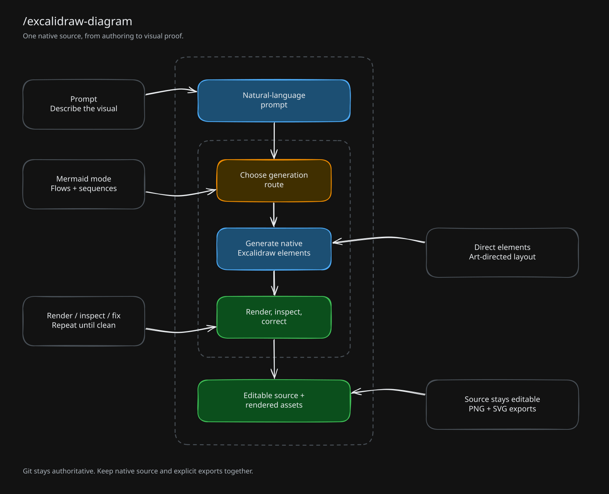

# Native diagram pipeline

A prompt selects Mermaid or direct-element authoring. Native elements then pass through rendering, visual inspection and correction before export. The dashed boundaries group the pipeline and its authoring/review steps; callouts explain the choices without relying on color.

[Editable scene](ai-pipeline.excalidraw) · [Official CLI PNG](ai-pipeline.png)

To intentionally redraw the example, run `bun run generate.ts --render` here. The recipe preserves semantic node IDs and needs no canvas server or account. After direct editing, the `.excalidraw` file remains authoritative; rerunning the recipe replaces those edits. Preserve them in Git first.
