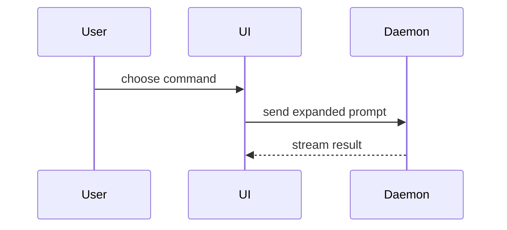

# Summary views

Pick the smallest view that makes the key point clear.

## UI change maps

For broad UI work, report requirements by surface: user problem -> observable change ->
annotated capture or flow -> acceptance check. All visible PR changes, including small ones,
follow [visual annotations](../commit-push-pr/REFERENCE.md#visual-annotations), not only broad
UI overviews. Distinguish base-versus-candidate from
off-versus-on comparisons. Name the setting path, default, gated changes, and changes that
still affect everyone; an off switch is not a full rollback when shared tokens also change.
Bind captures to build/commit and fixture/platform/viewport/theme; verify hosted assets still
load. Label missing or stale evidence instead of letting a polished overview imply coverage.

## Other views

- Show logic or an algorithm as pseudocode:

```text
on(save)
  if content is unchanged
    return cached result
  write new content
  return fresh result
```

- Show runtime control flow as a call tree:

```text
submitForm
  createSession
    persistPrompt
    launchAgent
  navigateToSession
```

- Show UI structure as a component tree, including state and module boundaries that matter:

```text
<SessionPage> (apps/example/src/routes/session.tsx)
  useSessionEvents()
  <SessionToolbar>
    <RunSkillButton> (packages/ui)
```

- Show file responsibility or a broad refactor as a shallow file tree:

```text
src/
├── commands/       # parses user actions
├── sessions/       # owns session state
└── transport/      # sends API requests
```

- Show component interaction, control flow, or data flow with Mermaid:



- Use `diff` when the point is what changes and the surrounding shape already exists. Match the diff shape to the topic.

For a component change:

```diff
 <SessionPage>
   useSessionEvents()
   <SessionToolbar>
+    <RunSkillButton />
   <SessionTimeline>
+    <SkillResultCard />
```

For a file-layout change:

```diff
 src/
 ├── commands/
+│   └── show-me.ts       # expands the slash command
 ├── sessions/
-└── transport.ts
+└── transport/
+    ├── client.ts
+    └── stream.ts
```

For a call-tree or call-stack change:

```diff
 submitForm
   createSession
     persistPrompt
+    expandSkillMention
     launchAgent
-  navigateToSession
+  navigateToSession
+    subscribeToEvents
```

For a state or control-flow change:

```diff
 on(save)
-  write content
+  if content is unchanged
+    return cached result
+  write new content
+  invalidate cache
```

- Show the whole block when most of it is new, when omitted context would hide ownership or order, or when the user needs a copyable target shape:

```ts
function expandSkill(command: string): string {
  const skillName = command.slice(1);
  return `use the ${skillName} skill`;
}
```


## Supporting description

After the deploy preview when applicable, lead with the change and why; follow the
[PR attention budget](../shared/communication.md#match-the-artifact). Keep only supporting
detail below it. The topics below are author guidance, not required PR headings.
Keep agent detail collapsed per the body template; retain required visual media inline after the
opening and any essential warning. Use the user's domain language from `GLOSSARY.md`.

### Summary

Add reviewer focus only when useful; do not repeat the opening sentence. Separate core
changes from generated or mechanical files; name useful review entry points without a
file-by-file inventory. Distinguish observed results from expectations.

Use the PR body as the operator digest: behavior/value, decisive evidence, domain decisions,
remaining risk/recovery and next action; link detail for resumption. Separate HTML or visual
recap artifacts need an explicit request; retain full-diff review and required visual evidence.

Choose the smallest view from [SUMMARY-VIEWS.md](SUMMARY-VIEWS.md).

#### Changed decisions

Surface material departures from a recorded plan or outcome contract when
scope, contracts, verification, or rollout risk changes. Reuse existing notes or intent maps:
prior choice -> new evidence -> current choice -> review consequence.
Keep the PR self-contained; omit empty histories and never invent a prior plan or agreement.

Session excerpts are optional context. Use only relevant,
authorized, redacted excerpts accessible to reviewers; otherwise give safe standalone rationale.
Do not widen sharing or execution access just to provide a link. Session length or turn count proves
neither correctness nor diligence; verify claims against the current diff and execution evidence.

Place visuals beside their supporting text. Show only load-bearing calls, files, props, states, and boundaries.

### Evidence

Concrete evidence that the change works. Prefer a short command/result; show before/after
for UI changes per the body template; for other changes, include media only when useful. Name checks not run and
remaining uncertainty; passing tests are not evidence of human review or consensus.

Use [visual annotations](../commit-push-pr/REFERENCE.md#visual-annotations) for hard-to-find deltas;
[UI change maps](SUMMARY-VIEWS.md#ui-change-maps) for broad UI only when helpful. Avoid duplicate captures/recaps.

For backend/API/Protobuf/contract, architecture, data-flow or workflow changes without
explanatory screenshots/video, include [backend diagrams](../excalidraw-diagram/PR-WORKFLOW.md)
inline after the opening; refresh stale maintained diagrams. Prefer Excalidraw, with inline
Mermaid when rendering/hosting fails. Keep test evidence: a diagram explains, not proves.
Use the [visual-evidence contract](../commit-push-pr/REFERENCE.md#frontendcustomer-facing-detection--screenshot-table-phase-5)
for scoped exceptions and the hosted-body completion gate.

Select media per [commit-push-pr visual evidence](../commit-push-pr/REFERENCE.md#frontendcustomer-facing-detection--screenshot-table-phase-5).
Every authored UI change needs a current clip via [package-my-work](../package-my-work/SKILL.md).
Other surfaces: record when interaction/motion needs it or requested. Review-only stays read-only.
Evidence earns its place by the question it answers, not media tier. Keep results concise and actual.

### Merge Danger

Name the rollback path and classify the change as a one-way or two-way door. Two-way doors are cheap to undo; destructive or hard-to-reverse decisions are one-way doors.

Name affected users, callers, contracts, and credible failure modes, including shared consumers.
Apply the handoff rubric's error-detection assessment alongside recovery; keep material
visibility gaps explicit rather than treating passing tests or a rollback plan as detection.

## Prototype hosting and verification

When interaction, hard-to-reach app states or alternative approaches benefit from hands-on
review, link a [UI prototype](../prototype/UI.md#shareable-review-prototype).
Use real app components/fonts/tokens/theme providers in a lightweight website; isolate
Electron/native/backend boundaries with labeled fixtures. Reviewers should reach the
relevant state without checking out a branch or arranging the full app environment.
For an open design question, expose meaningfully different approaches with shareable
variant/state URLs; a settled small edit needs neither variants nor a new prototype.

Deploy only through the target repository's documented, approved SSO-gated Quick Site
(or equivalent private preview) workflow. Discover its command/config; Shopify's
[Quick](https://shopify.engineering/quick) is inspiration, not access to infrastructure
or a portable deployment command. If hosting/SSO is unavailable, retain the runnable
artifact, report the gap and use screenshots; do not silently publish publicly or add
hosting/auth infrastructure. Verify reviewer access, link target state and asset loading;
check logged-out access is denied before calling it SSO-gated. Identify simulated behavior
and unverified access. Keep the URL/artifact tied to the reviewed revision; refresh it or
mark it stale after relevant changes. Follow [prototype retention](../prototype/SKILL.md#retention).
