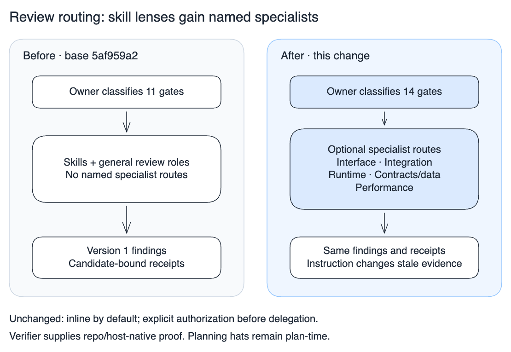

# Review roles and routing

`/review` owns PR review; `/review --deep` adds a full applicability ledger.
`/visual-review` remains the standalone surface-audit front door. Reviewer roles
are conditional lenses, not an agent-per-skill fan-out. Use them inline by default;
explicit delegation authorization is required before dispatch. One owner classifies
all changed behavior, synthesizes findings and preserves the requested endpoint.

## Registered roles

The [plugin manifest](../.claude-plugin/plugin.json) registers twelve definitions.
Eight produce findings, one executes verification, three review plans:

| Role | Responsibility |
| --- | --- |
| [code-reviewer](../agents/code-reviewer.md) | Fresh-eyes spec compliance, correctness, source quality |
| [self-reviewer](../agents/self-reviewer.md) | Author-side gaps, simplification, test and CI readiness; not independent |
| [adversarial-reviewer](../agents/adversarial-reviewer.md) | Evidence-triggered security, failure and recovery scenarios |
| [verifier](../agents/verifier.md) | Runs repository/host-native checks and captures observed proof; not semantic approval |
| [interface-reviewer](../agents/interface-reviewer.md) | Rendered surfaces, accessibility, copy, localized layout; visual-review composes the six better-interface domains |
| [integration-reviewer](../agents/integration-reviewer.md) | Harness/host integrity, content propagation, CI, dependencies and vendoring |
| [runtime-reviewer](../agents/runtime-reviewer.md) | Cancellation, races, stale results, retries and resource ownership/cleanup |
| [contracts-data-reviewer](../agents/contracts-data-reviewer.md) | API/schema/database compatibility, migrations and lossless data interpretation |
| [performance-reviewer](../agents/performance-reviewer.md) | Measured UX, bundle, animation, backend and compiler cost |
| [plan-product-hat](../agents/plan-product-hat.md) | Plan-time requirements, beneficiary, value and scope |
| [plan-design-hat](../agents/plan-design-hat.md) | Plan-time journeys, accessibility, states and copy |
| [plan-engineering-hat](../agents/plan-engineering-hat.md) | Plan-time architecture, feasibility, security, performance and tests |

Definitions ship as guidance in both bundles; Claude registration does not imply a
native Codex agent type. On another host, an authorized coordinator can give the
chosen supported worker the definition and pinned input. Use the actual executor,
model and dispatched reviewer identity. An inline owner is never an independent
agent. Skill activation grants neither delegation nor browser/production access.

## Conditional coverage

The executable [gate catalogue](../config/review-gates.json) owns gate ids, path
hints and optional `reviewer` suggestions. [GATES.md](GATES.md) owns semantic
classification and candidate-bound receipts. The planner exposes suggestions and
loads their instruction paths; it never starts agents, models, tests or browsers.
No new consumer opt-in or merge requirement is installed by adding these roles.

- Correctness stays with code review; product and lie-detector hats stay inline.
  Test integrity stays with author/code review, informed by verifier evidence.
- Surface review routes to interface review. It loads `visual-review` and its
  six better-interface domains, not the explicit-only `/interface-review` skill.
- Harness/host integrity and content propagation are separate conditional gates
  owned by integration review. Dependencies/licenses and operations reuse that role.
- Runtime lifecycle is a separate conditional gate. Data fidelity extends existing
  contracts/architecture review; protobuf contracts use the same reviewer with their
  dedicated skill and receipt.
- Security/recovery retains adversarial review; performance uses its specialist.
  Documentation retains code review. Planning hats do not replace implemented review.

Path matches are hints for conservatively including a gate; classification must
also inspect behavior. Generic filenames can hide cancellation, localization or
payload loss. A single role assigned several gates must satisfy each lens and
receipt; it cannot reuse one approval as unrelated coverage.

Integration owns freshness/completeness; interface owns meaning and rendered
RTL/expansion. Runtime owns interleavings/lifetimes; contracts/data owns value
interpretation. Security owns abuse/recovery; performance owns measured cost.
Deduplicate shared root causes in the owner's report, retain supporting evidence.

## Evidence boundaries

The [specialist contract](../agents/references/specialist-review.md) and
[findings schema](../agents/references/findings-schema.md) apply to all five new
finding-producing roles. Missing current evidence stays explicit. The verifier's
PASS/FAIL/UNAVAILABLE receipt supplies proof, not a gate approval; the assigned
reviewer judges sufficiency. Planning hats retain their plan format.

Deterministic freshness, budget, scan and install checks complement these lenses.
They do not establish model adherence, independent review or better defect recall.
A role definition is available coverage, not evidence it ran.

## Routing change

[Editable scene](../docs/architecture/review-specialists.excalidraw). The before
panel is reconstructed from `origin/main` at `5af959a2`; the after panel represents
this change. Source: `definitions` / `createPlan` in
[scripts/review-gates.ts](../scripts/review-gates.ts) and the gate catalogue.
The public CLI/event contracts in
[scripts/review-gates.test.ts](../scripts/review-gates.test.ts) exercise routing,
receipt integrity and role identity; the diagram does not prove reviewer quality.
