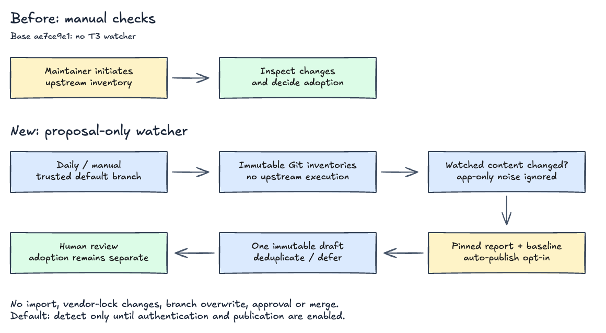

# T3 harness watcher

Daily detection replaces repeated manual upstream inventories. Publication is **off by
default** until authentication is chosen; this setup does not change repository settings.
The bot proposes review work, not autonomous skill adoption. No model/API key required.



[Editable architecture](../docs/architecture/t3-harness-watcher.excalidraw). Before: no
T3 watcher at the comparison base. New path: trusted workflow → immutable inventory →
optional two-file draft → human adoption. Sources: the workflow and watcher CLI; verified
by public CLI contracts below. The diagram describes behavior, not proven hosted activation.

## Detection and scope

[`watch-t3code-harness.py`](../scripts/watch-t3code-harness.py) compares two immutable
commits. “Meaningful” is conservative path/blob/mode change, **not** AI judgment of
semantic value. Whitespace counts; application-only commits do not. Added/deleted files,
executable bits and symlink targets count; symlinks are never followed.

Watched inputs:

- `AGENTS.md`, `CLAUDE.md`, `CONTRIBUTING.md`, `LICENSE`;
- `.agents/`, `.claude/`, `.codex/`, `.repos/effect-smol/.agents/`;
- `.repos/effect-smol/LICENSE`, `.github/triage/`, `.github/TRIAGE_EXEMPTIONS.td`;
- `scripts/lib/reference-repos.ts` (reference-repository setup).

Other reference repositories, app workflows and recursively linked files outside this
scope are excluded. An empty/unavailable inventory fails visibly, never claims no change.
Scope is intentionally fixed in the script; maintain it if upstream moves its harness.

The initial baseline equals the existing [vendor lock](../vendor/t3code-skills.lock.json)
pin, so previously unreviewed **non-skill harness changes** can produce the first proposal.
The [watcher baseline](../config/t3code-harness-watch.json) thereafter advances only by
merging a proposal. It is independent of the vendoring pin: merging **does not mean
skills were imported**, and the bot cannot change skills, host policy or the vendor lock.

## Proposal contract

Only two paths change on a proposed branch:

- `reports/t3code-harness-watch.md`: pinned comparison, added/modified/removed input
  inventory and categorized review/adoption suggestions; no untrusted source excerpts.
- `config/t3code-harness-watch.json`: candidate becomes the next acknowledged baseline.

The fingerprint covers all watched tree entries, independent of app-only commit churn.
Branches use `ben-malinski/t3-harness/<fingerprint>`. The bot creates a new ref; it never
updates or force-pushes existing branches. PRs are drafts, with no approval/merge path.
One open watcher proposal defers later changes until a later run after it is resolved.
Closed proposals suppress the same fingerprint, including after branch deletion; a new
watched state can produce another proposal. Maintainer edits are never overwritten.

Review pinned diffs, then explicitly import/adapt useful changes with the existing
[vendoring workflow](../vendor/t3code-NOTICE.md). New skills still need compatibility
adapters; unknown skills must continue failing the importer. To acknowledge without
adopting, merge the report/baseline proposal only. To dismiss, close it without merging.

## Activation (after setup merges)

1. Merge this setup. Scheduled/manual Actions workflows run from the **default branch**;
   this draft alone is not an active bot. Daily `09:43 UTC` runs initially detect only.
2. Choose authentication. No choice or repository setting is changed by this setup:
   - **Built-in `GITHUB_TOKEN`:** enable the repository's combined **Allow GitHub Actions
     to create and approve pull requests** setting. The watcher only creates drafts; it
     never approves them. Its job requests `contents: write` and `pull-requests: write`,
     with no persisted checkout credentials. The setting enables a broader capability
     for the repository, so it needs an explicit owner decision.
   - **GitHub App:** alternative when that combined setting is undesirable or automatic
     PR CI is required. Configure a repository-scoped App with Contents and Pull requests
     write permissions; add a reviewed, SHA-pinned installation-token step and supply
     its short-lived token to the publication step. App provisioning is **not implemented**
     here; never put a private key in the workflow or upstream tree.
3. With the chosen token working, manually dispatch **Watch T3 harness** without `publish`
   for a dry-run. Inspect its Actions summary, then dispatch with `publish` to test the
   draft path. Finally set repository variable `T3_HARNESS_WATCH_ENABLED=true` for scheduled
   publication. Missing/other values keep scheduled runs read-only. Manual `publish`
   deliberately overrides that variable and still requires working permissions.

[GitHub documents](https://docs.github.com/en/actions/concepts/security/github_token)
that PR `opened`, `synchronize` and `reopened` events from `GITHUB_TOKEN` create workflows
requiring approval by a user with write access. Do **not** assume automatic green CI;
use **Approve workflows to run**, or the reviewed App alternative. The watcher grants
no `actions: write`, changes no protection rules and bypasses no required checks.

Schedules are best effort, not webhooks: GitHub can delay/drop runs and disable schedules
in inactive public repositories. Run manually if needed. See
[workflow event behavior](https://docs.github.com/en/actions/reference/workflows-and-actions/events-that-trigger-workflows)
and [Actions repository settings](https://docs.github.com/en/repositories/managing-your-repositorys-settings-and-features/enabling-features-for-your-repository/managing-github-actions-settings-for-a-repository).

## Local inspection and verification

```sh
# Existing upstream Git object store, including both full commit SHAs. No checkout required.
python3 scripts/watch-t3code-harness.py --source /path/to/t3code.git --revision FULL_SHA
python3 evals/test-t3code-harness-watch.py
bash evals/run.sh t3code-harness-watch
actionlint .github/workflows/watch-t3code-harness.yml
```

Dry-run writes nothing to the checkout and needs no GitHub token. Publication additionally
uses `--publish --repository OWNER/REPO --base main`, the real default-branch name, `gh`
and a fresh trusted checkout matching the remote base. It makes Git Data API writes for
only the two proposal paths, not a local Git commit or push. Upstream code is never run.
The workflow uses a bare object store, a SHA-pinned checkout action, bounded timeouts and
non-cancelling publication concurrency. Workflow inputs cannot select another source repo,
script, upstream ref or checkout branch.

## Failure, recovery and shutdown

Fetch, schema, API, permission, size-limit and stale-checkout errors fail the run visibly.
An uncertain ref/PR create triggers readback, **not** a write retry. If a ref exists without
a confirmed PR, later runs fail rather than overwrite it. Inspect its commit/parent and
exact two-file diff, then open its draft manually or remove the orphan ref after review.
Do not delete a branch with maintainer edits. Fix the underlying permission/network error
before another publish attempt; inspect PR history first to avoid duplicates.

Unset `T3_HARNESS_WATCH_ENABLED` to stop scheduled publication; daily detection continues.
Disable the workflow to stop all runs. Neither action closes drafts or deletes branches.
Reverting this setup removes scheduling/code; already-created drafts remain for explicit
human disposition. No live hosted publication is proven by fixture tests.
