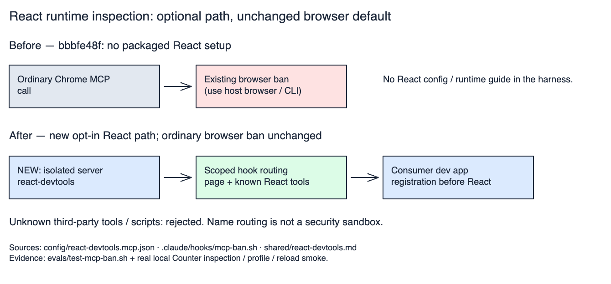

# React runtime inspection

Use for React state/ownership bugs or render-cost hypotheses during diagnosis,
performance work, or dogfood. Optional instrumentation, not a new verification gate.
Keep the existing project verifier and host browser as the default. Missing React
tools do not block unrelated work or justify a browser takeover.



[Editable routing diagram](../docs/architecture/react-devtools-routing.excalidraw).
Sources: the config and hook below; verified by `evals/test-mcp-ban.sh` and a local
Counter inspection/profile/reload smoke. This describes routing, not a sandbox.

## Opt-in setup

The harness ships guidance and a [pinned MCP config](../config/react-devtools.mcp.json),
not an automatically enabled server or an app dependency. Configure only when React
runtime inspection is in scope. Preserve existing MCP registrations.

1. Merge the template's `react-devtools` entry into the client's supported MCP config.
   In Codex, use `codex mcp add react-devtools -- COMMAND ARG...`, substituting the
   template's `command` and complete `args`; verify with `codex mcp get react-devtools`.
   Keep this server name: the harness hook permits its bounded React workflow while
   retaining the ordinary browser MCP ban. Reload MCP connections as required by the host.
2. In the **consumer app's owning workspace**, use its package manager to add the
   development dependency. Bun example:

   ```sh
   bun add -d --exact react-devtools-cdt-mcp@0.1.0
   ```

3. Use the consumer's bundler to select a **browser-only development entry** which
   loads registration before the existing React bootstrap:

   ```ts
   import 'react-devtools-cdt-mcp/register';
   import './bootstrap';
   ```

   `./bootstrap` stands for the app's existing module that initializes React.
   Production must select the original bootstrap directly; SSR and test entrypoints
   must not import registration. If using a conditional dynamic import instead,
   await registration before dynamically importing the app; static React imports
   are evaluated before a runtime condition. Reuse the consumer's environment policy.
4. Run its development server. Verify the production bundle excludes instrumentation
   and SSR/tests still work. Remove the dev dependency/bootstrap and MCP registration
   to roll back; keep unrelated client settings intact.

The template pins Chrome DevTools MCP 1.12.0, enables experimental third-party tools,
uses a temporary isolated profile, disables usage statistics/CrUX lookups and generic
JavaScript evaluation, and restricts browser requests to HTTP loopback URLs.
It requires Bun, a Node runtime satisfying the server's `engines`, and Chrome 149+
for URL restrictions. Local HTTPS, API/asset origins, or other page hosts need explicit
scoped allowances; retain isolation and never attach to a human-owned profile.
No automatic installs or whole-client config replacement; keep production and
background watchers untouched.

## Inspect, act, replay

1. Discover the exposed MCP tools. With `react-devtools`, open the trusted local app
   using `new_page`; retain its page ID. Read tool schemas rather than inventing args.
   Inspect only this owned page; close it when finished. Do not assume T3's preview
   exposes Chrome MCP tools, shares its browser session, or supplies compatible UIDs.
2. Call `list_3p_developer_tools` for the owned `pageId`. Confirm a `react` group and
   the required tool schemas.
   If absent, check selected page, bootstrap ordering and the experimental flag once;
   otherwise record unavailable and continue with the existing browser/test path.
3. Call `execute_3p_developer_tool` with that `pageId`, `toolName` and parameters
   matching discovery. In the pinned server, `params` is a **JSON string**, not an
   object: `{"pageId":2,"toolName":"react_find_components","params":"{\"name\":\"Counter\"}"}`.
   Start with `react_find_components` or a bounded `react_get_component_tree`.
   `react_get_component_by_dom_element` accepts this server's snapshot element UID
   and returns a **host node**, not its function component. Follow
   `react_get_owner_stack` or `react_get_parent_stack`, then inspect the relevant
   function component with `react_get_component_by_uid` and `react_get_component_source`.
   Use `includeHooks: true` only when needed. Parent placement and JSX ownership differ.
4. For render-cost hypotheses: `react_start_profiling` -> replay one named interaction
   with `click`/`fill`/`press_key` -> `react_stop_profiling` ->
   `react_get_trace_overview` -> `react_get_commit_report`. Retain the trace name;
   read timings in milliseconds. Inspect hooks **outside** the timed interaction.
5. Treat `{error: ...}`, null timings/source, or an empty tree as missing evidence,
   not success. Reacquire component UIDs after reload; DOM snapshot UIDs and React
   component UIDs are different handles. Stop an active profiler during cleanup.
6. Bind redacted observations to the app revision, route, fixture, interaction and
   instrumentation versions. Replay the actual user-visible behavior and regression
   test after changes. A component dump or successful tool call is not a dogfood PASS.

## Safety and interpretation

- Props/hooks can contain credentials or personal data. Use synthetic/local test data;
  inspect the smallest subtree and redact evidence before saving or publishing it.
- These are observation/profiling tools, not prop/state mutation APIs. The hook rejects
  other third-party tool names and generic script execution under `react-devtools`.
  The name-based exception is routing, not a security sandbox; retain trusted pages
  and the template's browser isolation/network restrictions.
- Registration adds commit-reporting overhead. Hook inspection re-executes render
  functions without running effects. Neither observation is free of perturbation.
  React traces localize work; prove UX gains with paired production-like measurements
  under [UX performance](../ux-performance/SKILL.md), not instrumented dev timings alone.
- APIs/output are experimental. Before changing either pin, recheck upstream schemas,
  the hook's supported operations, and a live inspection/profile/reload smoke test.
  Retain ordinary tests, accessibility/visual checks and browser fallbacks.

## Sources

Reviewed 2026-10-22; registry pins: `react-devtools-cdt-mcp` 0.1.0 and
`chrome-devtools-mcp` 1.12.0.

- [React setup and troubleshooting](https://react.dev/reference/dev-tools/react-devtools-cdt-mcp)
- [React tool schemas and inspection caveats](https://github.com/facebook/react/tree/main/packages/react-devtools-cdt-mcp)
- [Chrome configuration and isolation](https://github.com/ChromeDevTools/chrome-devtools-mcp/blob/af2834411a564d366f9cab63efb046d9084f4dba/docs/configuration.md)
- [Codex MCP configuration](https://developers.openai.com/codex/mcp/)
